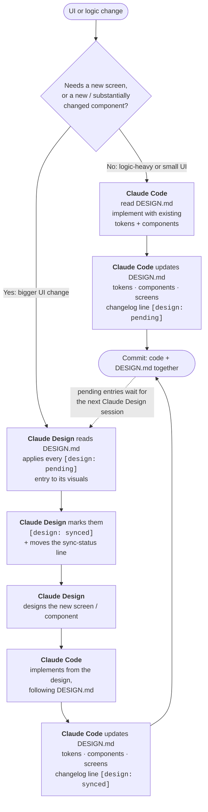

# DESIGN.md — Kacey UI

The single source of truth for the Kacey interface. Everything here comes from the
code as it is. Where the code disagrees with itself, the disagreement is listed in
[§7](#7-inconsistencies-and-debt) and not settled here.

**Before a UI change:** read this file. **After it:** update the tokens, components,
screens and changelog sections in the same commit.

> **Claude Design sync:** synced through `2026-10-07` (every pending entry from 2026-10-01 to 2026-10-07: routine on dates, Druhý monitor, launcher Čtení oznámení, mini player seek — drawn into Kacey Desktop, Kacey Android, MiniVinyl and Kacey Music; handoff `handoff/design-sync-2026-10-07.md` in the design project). The phone layouts of the routine pieces follow in the next sync. The design files, start page **Kacey Index**: **Kacey Desktop** (was "Kacey Redesign"), **Kacey Phone** + **Kacey Phone App** (was "Kacey Mobile"), **Kacey Night and Morning** (was "Kacey DREAM"), **Kacey Android**, MiniVinyl, MusicCorner, Kacey Music, Kacey Lights, and the shared lane component **DayTimeline**.
>
> **Kacey Self-Update (2026-10-15):** built from the design project's `Kacey Self-Update.dc.html` (canvas 1a–1h, 1g phone) and `Kacey Self-Update Prototype.dc.html` (the interactive flow, plus the chat's conversation history). The two `… - ukoly-skupiny` files there are the *example output* of the loop (task groups), not a change to build by hand.
>
> **Waiting to be designed:** the `notifications` page and the Instagram `dms` window. The backend, the API and the Android relay are built; the screens are not. The brief is [docs/design-brief-notifications.md](docs/design-brief-notifications.md), and the two rows marked *planned* in §6.
>
> **Waiting for the next Claude Design sync:** the `storage` screen (Úložiště, draft 2026-10-23, with its náhled `.fview` from revize 2 — drawn from the tokens, desktop and phone, no design yet), the two whiteboard screens (`boards`, `board`, KC 1.0.6 — drawn straight from the tokens and approved by the owner as built; Claude Design has not drawn them yet, phone layout included), and the phone (≤760px) layout of the routine on dates. Kacey Phone App still draws the 2026-09 calendar (no block editor, + Blok, sick sheet; a dashed "Upraveno jen pro tento den" card instead of `.routinebar`), so the phone keeps the desktop's controls as a bottom sheet for now — see §7 (Routine on dates).

---

## 0. Design implementation loop

Which tool does the work depends on the size of the UI change.

| Change | Tool | Examples |
|---|---|---|
| Logic-heavy, or a small UI change | **Claude Code** only | New state on an existing component, a new modifier, a copy/spacing fix, wiring a view to data |
| Bigger UI change | **Claude Design** first, then **Claude Code** | A new screen, a redesigned screen, a new or substantially changed component, a layout template change |

- **Small path:** the design falls behind the code on purpose. The `[design: pending]` tag records exactly what's behind.
- **Big path:** Claude Design always catches up on `pending` entries *before* it designs anything new, so it never builds on a stale picture of the app.
- The new work on the big path goes in as `[design: synced]`, because the design already has it.

**Rule of thumb:** if a change can be described with the components in §3, it's small. If it needs a component or layout that isn't there yet, it's bigger.

---

## 1. Overview

| | |
|---|---|
| Framework | None. Vanilla JS, native ES modules, no build step, no dependencies ([ARCHITECTURE.md § Frontend](ARCHITECTURE.md#frontend)) |
| Styling | One hand-written stylesheet, BEM-style class names, CSS custom properties for tokens. No preprocessor, no utility framework |
| Component library | None. A "component" is a CSS block (`.card`, `.btn`, …) plus, for dynamic parts, an `el()` call in the module that renders it |
| Markup | [public/index.html](public/index.html) holds the whole shell: header, every view (hidden until routed to), the sheets, the toast, the tab bar |
| Styles | [public/styles.css](public/styles.css), ordered by section: tokens → base → header → views/layout → cards → controls → chat → lists → journal → calendar → brief → timers → controller → runner/focus → sheets → voiceprint → toast → phone overrides |
| DOM building | [public/js/core/el.js](public/js/core/el.js) — `el('tag#id.class', attrs, children)`. No `innerHTML` anywhere for user/model text |
| Routing | [public/js/ui/router.js](public/js/ui/router.js) — flips `hidden` on `.view[data-view]`, mirrors to `location.hash`. Any `[data-go="view"]` navigates |
| Theme | [public/js/ui/theme.js](public/js/ui/theme.js) — writes one number, `--h`, to `:root`; persisted in localStorage, `?hue=` overrides per load |
| Strings | Chrome strings in [public/js/core/i18n.js](public/js/core/i18n.js) (`cs-CZ`, `en-US`); view copy is hardcoded Czech in HTML/JS (see §7) |
| Theme mode | Dark only (`<meta name="color-scheme" content="dark">`) |

Design principles stated in the stylesheet header: neutral greys, **one** accent,
monospace throughout, **no border radii** (only round status dots), surfaces never
take the hue.

**Installable.** [manifest.webmanifest](public/manifest.webmanifest) (standalone, `--bg` background and theme colour, icons in `public/icons/`: the `.top__mark` square in `--acc` at hue 193 on `--bg`) makes the page an installable app and an Android share target; [sw.js](public/sw.js) only catches shares and caches nothing.

**Android app.** [android/](android/) wraps this same page in a WebView, as a floating bubble and full screen; its only native screen is the launcher/settings screen (`activity_main.xml`), drawn in the tokens from §2 (`bg`, `l1`, `l2`, `line2`, `ink*`, `acc`), monospace, square controls. It also runs a notification relay (`NotificationRelay.kt`): a copy of every phone notification goes to the server, which feeds the planned `notifications` and `dms` screens (§6). The relay has no UI of its own beyond a launcher status row. See [android/README.md](android/README.md).

**Out of scope:** [voicelab/public/](voicelab/public/) is a separate dev tool (port
8788) with its own, unrelated palette, sans-serif font and 12px radii. Nothing below
applies to it.

---

## 2. Design tokens

All tokens are defined in `:root` in [public/styles.css:13-44](public/styles.css:13).
Rows marked *(literal)* are values used repeatedly but **not** tokenised yet.

### Colour

| Token | Value | Usage |
|---|---|---|
| `--h` | `193` (set at runtime by theme.js) | The single hue. Presets: 1 RED, 33 AMBER, 150 JADE, 193 CYAN, 225 BLUE, 285 VIOLET |
| `--bg` | `#161616` | Page background, input fields, phone dock |
| `--l1` | `#242424` | Level 1 surface: header, cards, sheets, tab bar |
| `--l2` | `#2f2f2f` | Level 2: buttons, bubbles, tiles, entries, hover rows, "current" row |
| `--l3` | `#3a3a3a` | Level 3: hovered buttons, chips, user bubble, bar tracks |
| `--line` | `#414141` | Default 1px borders and dividers |
| `--line2` | `#565656` | Stronger borders: controls, inputs, sheet box |
| `--ink` | `#f4f4f4` | Primary text |
| `--ink2` | `#c6c6c6` | Secondary text, meta |
| `--ink3` | `#9a9a9a` | Tertiary: timestamps, labels, disabled-looking, past items |
| `--acc` | `hsl(var(--h) 88% 66%)` | The accent: primary buttons, focus ring, "now", pressed states, progress fill |
| `--acc-dim` | `hsl(var(--h) 88% 66% / .16)` | Accent wash: pressed button/switch bg, listening strip, drop target |
| `--acc-press` | `hsl(var(--h) 88% 76%)` | Pressed accent fill (`.btn--accent:active`); Android `acc_press` in `btn_accent.xml` |
| `--on-acc` | `#161616` | Text on an accent fill |
| `--ok` | `#42be65` | Connected, done checkbox, allowed tool, voiceprint hit |
| `--ok-dim` | `rgb(66 190 101 / .14)` | Wash behind the "Nová verze připravena" chip |
| `--warn` | `#f1c21b` | Mock badge, telemetry warnings, "planned" rows, "Ke schválení" chip |
| `--warn-dim` | `rgb(241 194 27 / .12)` | Wash behind the "Ke schválení" chip |
| `--err` | `#fa4d56` | Errors, destructive controls, overdue, system bubbles. Fixed — never derived from `--h` |
| `--wb-bg` | `#0e0e0e` | The whiteboard's plane (darker than `--bg`, so `--l1` cards lift off it); the board tiles' frames |
| `--wb-dot` | `#343434` | The whiteboard's grid: a 2px square dot every 24px of the board (`conic-gradient`), doubled apart when zoomed far out |
| `#2e2e2e` *(literal)* | | Row divider inside lists (`.rowbtn`, `.task`, `.tick`, `.cyclestep`, `.readout__row`, `.srow`) |
| `#0b2a14`, `#1d2a20` *(literal)* | | Text on `--ok` fill; done runner item bg |
| `#160203` *(literal)* | | Text on `--err` fill (`.btn--dangerfill`) |
| `#1c1c1c`/`#232323`/`#242424` *(literal)* | | Diagonal hatch for sleep hours (calendar lane, routine grid) |

**Data colours** (JS literals, not tokens):

| Where | Values |
|---|---|
| Routine categories, [routine.js:25-31](public/js/views/routine.js:25) | routine `#d2a106`, gym `#ee5396`, work `#009d9a`, study `#a56eff`, free `#24a148`, commute `#8d8d8d`. Alpha suffix `66` in the grid, `1f` in the calendar lane |
| Class types, [routine-cats.js](public/js/core/routine-cats.js) `KINDS` | přednáška `#fddc69`, cvičení `#a7f0ba`, laboratoř `#a6c8ff` — light tints that read on any category colour |
| Calendar sources, [calendar.js:83](public/js/ui/calendar.js:83) | `var(--acc)`, `#78a9ff`, `#08bdba`, `#d2a106`, `#ee5396`, `#a56eff` (assigned by first-seen order) |
| Whiteboard colours, [core/board.js](public/js/core/board.js) `COLORS` | šedá `#8d8d8d`, žlutá `#d2a106`, zelená `#24a148`, tyrkysová `#009d9a`, modrá `#78a9ff`, fialová `#a56eff`, růžová `#ee5396`, červená `#fa4d56` — the two palettes above, named so Kacey can say them. A card's 4px edge and kicker; a rectangle's fill at 13 % and border at 65 % (`color-mix`) |

### Typography

| Token | Value |
|---|---|
| `--mono` | `"Consolas", "SFMono-Regular", "Menlo", ui-monospace, monospace` — the only family |
| Body | 15px / 1.5, `-webkit-font-smoothing: antialiased` |
| Weights | 400 and 600 only (600 = every "bold") |
| Numbers | `font-variant-numeric: tabular-nums` on every clock, count and time (`.num` helper) |

Size scale in use *(literals, no tokens)*:

| px | Used for |
|---|---|
| 10–11 | Tab labels (10 at ≤360px) |
| 12 | `.label`, `.preset`, tick times, badges, phone header view label |
| 13 | Default small: `.card__title`, `.btn`, meta, `.muted`, `.chip` |
| 14 | Inputs, `.btn--fn`, subheads, sheet/entry body |
| 15 | Body, `.card__title--lg`, `.sheet__title`, row titles, `.btn--lg` |
| 16 | Chat bubble, composer input (never below 16 on phone — iOS zoom) |
| 17 | Current row title, entry `h3`, tile value, journal prose |
| 18–20 | `.briefline` (current 20), `.big`, `.runitem__label` |
| 28–34 | Phone runner title, `.clock--sm` 30, `.clock` 32, done timer 34 |
| 40–64 | `.timercard__big`/`.runner__title` 40, `.focus__title` 44, `.focus__clock` 64 (52 phone) |

Line heights: 1.5 body · 1.6 bubbles, prompt, brief lines, entry text · 1.65 sheet notes · 1.75 journal prose.
Letter-spacing: `.04em` brand/titles-lg, `.06em` card/sheet titles, `.08em` `.label` and phone view label.

### Spacing

| Token | Value | Usage |
|---|---|---|
| `--gap` | `8px` | Gap and padding between every top-level panel (body, `.view`, `.col`, `.dock`), toast offset |

Everything else is literal. Recurring values: **4, 6, 8, 10, 12, 14, 16, 20, 24** px.
Card head/sub/rows use `10px 14px`; sheets use `20px` horizontal; chat log `20px 24px`.

### Radii

None. Everything is square by design. The only exception is `border-radius: 50%` on
status dots (`.conn__dot`, `.btn .dot`).

### Shadows *(literals)*

| Value | Where |
|---|---|
| `0 2px 6px rgb(0 0 0 / .35)` | `.eblock` (calendar event) |
| `0 2px 6px rgb(0 0 0 / .4)` | `.toast` |
| `0 2px 6px rgb(0 0 0 / .5)` | `.sheet__box` |
| `0 8px 24px rgb(0 0 0 / .5)` | `.mini__drop` (the header mini player's panel; the same shadow as nowplayingd's corner widget), `.sticky` |
| `0 0 12px rgb(0 0 0 / .5)` | `.updlg` (the self-update popup), as drawn in Kacey Self-Update |
| `rgb(0 0 0 / .6)` | Sheet backdrop, `.upmodal`, the phone `.uprefine` scrim |

### Breakpoints *(literals, in styles.css)*

| Query | Effect |
|---|---|
| `max-width: 1100px` | `.view--triple` drops its left `.col--stack` column |
| `max-width: 760px` | **Phone layout** — its own design (Claude Design "Kacey Phone"): 52px header naming the view, five-tab bar, cards inset 12px, 44px+ targets, bottom sheets (the `@media (max-width: 760px)` block at the end of [styles.css](public/styles.css)) |
| `min-width: 761px` | Hides `.phone-only` controls on desktop |
| `max-width: 900px and max-height: 460px` | Landscape phone: icon-only tabs, 38px header |
| `max-width: 360px` | Smallest: hides the header's short state, 2-col timer presets |

### Z-index *(literals)*

| Layer | z | Element |
|---|---|---|
| Sticky day column (phone routine grid); event in a lane column | 2 | `.grid__day`, `.eblock--col` |
| Now line | 3 | `.nowline` |
| Sticky dock / inline event editor | 5 | `.dock` (phone), `.eventedit` |
| Sticky column heads (multi-day lane) | 7 | `.colheads` |
| Routine block note editor | 8 | `.noteedit` |
| Routine block editor / + Blok card over the lane | 9 | `.eventedit--routine`, `.eventedit--add` |
| History button / its panel (inside the chat card) | 3 / 4 | `.histbtn`, `.histpanel` |
| Header mini player's panel; the self-update chip's dropdown | 20 | `.mini__drop`, `.updrop` |
| Lístečky (sticky notes over every page, desktop) | 25 | `.stickies` |
| Whiteboard: loading cover / file drop / tools, Kacey's line and the selection bar / the corner button and its menu | 8 / 9 / 15 / 20 | `.wbloading`, `.wbdrop`, `.wbtools` `.wbask` `.wbsel`, `.wbnav` |
| Music visual over the kiosk page | 50 | `.visualover` |
| Sheets (modals); phone scrim | 30 | `.sheet`, `.scrim` |
| Phone bottom sheet | 31 | `.is-psheet-open` |
| Self-update popup | 35 | `.upmodal` |
| Toast; self-update toast | 40 | `.toast`, `.uptoast` |
| Switching to the new version (covers everything) | 60 | `.upswitch` |

### Motion

| Token / value | Where |
|---|---|
| `--motion` = `110ms cubic-bezier(.2, 0, .38, .9)` | Button bg, switch knob. Becomes `1ms linear` under `prefers-reduced-motion` |
| `150ms cubic-bezier(.2, 0, .38, .9)` *(literal)* | `.bar__fill` width |
| `60ms linear` *(literal)* | `.meter__bar` height |
| `900ms linear` *(inline in timers.js)* | Timer countdown bar |
| `@keyframes pulseDot` | Connection dot 2.4s (1.1s when active), talk-button dot 1.2s; self-update chip / card dot and current step box 1.4s, `.upswitch__dot` .8s |
| `@keyframes caret` | Streaming caret, `1s steps(2)` |

Reduced motion also forces every animation to 1ms / 1 iteration, and the orb's
rAF amplitude loop stops ([orb.js](public/js/ui/orb.js)). `body.is-hidden` stops the dot pulse when the tab is hidden.

---

## 3. Components

Each is a CSS block in [public/styles.css](public/styles.css). "JS" names the module that builds it dynamically.
States use `is-*` classes, `aria-pressed`/`aria-current`, or `data-*`.

### Layout

| Component | Purpose | Variants / parts | States | Example |
|---|---|---|---|---|
| `.view` | One routed screen | `--triple`, `--wide`, `--split`, `--full` (see §4); `data-view` | `hidden` | `<section class="view view--wide" data-view="tasks" hidden>` |
| `.col` | Column inside a view | `--stack` (2 rows 1.1/.9), `--stack-auto` (auto/1fr), `--chat` (log/dock), `--rail` (scrolls), `--scroll` | — | `
` |
| `.card` | The panel. `--l1` bg, 1px `--line` border | `--pad`, `--flush`; parts `__head`, `__sub`, `__title` (`--lg`, `--bar`), `__body` (`--scroll`), `__foot` (`--block`) | — | `<section class="card">
<h2 class="card__title">Dnes</h2>
…` |
| `.sheet` | Modal overlay | `--bottom`; `__box` (`--narrow` 520, `--wide` 760, `--xwide` 1080, `--sheetbottom`), `__head`, `__title`, `__close`, `__bar`, `__lede`, `__body`, `__foot`, `__note` | `hidden` | `

` |
| `.runner` / `.focus` | Full-bleed task screens | `runner__head/title/list/add/foot`; `focus__title/clock` | — | `
<h1 class="focus__title">` |
| `.visualover` | The music visual (nowplayingd) in a full-screen frame over the kiosk page, opened from the mini player's link; `__frame`. Closes when the frame posts `kacey:close-visual` (MusicCorner's "Kacey" link); no close button of its own. Kiosk only: cage cannot take a second window | `hidden` | `
` |
| `.viewbar` / `.embed` | Header row + full-height iframe for a view that frames a separate app (lights) | `.embed__off` (notice card when off or unreachable) | `hidden` | `<iframe class="embed" id="lightsFrame">` |
| `.psheet` + `.scrim` | A panel that sits in the page on desktop and becomes a bottom sheet on a phone ([psheet.js](public/js/ui/psheet.js)): calendar sources, event editor, journal KC chat. `__head` (title + `[data-psheet-close]`) | — | `.is-psheet-open` (phone only has an effect); scrim `hidden` | `openSheet($('calSourcesSheet'))` |
| Helpers | `.row` (flex, gap 8, wraps; `.center`), `.push` (margin-left:auto), `.narrow` (60ch), `.center`, `.sr-only`, `.phone-only` / `.desk-only` (shown on one layout only), `.pairrow` (two equal buttons) | | | `` |

### Navigation

| Component | File | Purpose | States | Example |
|---|---|---|---|---|
| `.top` | index.html | Header: `__brand`, `__mark`, `__name`, `__title` (phone: the view's name, set by router.js), `.topchip`s, `__stats` (KC version · model · mcp · turns; hidden on a phone), `__badge`, `__end` (`__view`, `.mini`, `.lightchip`, the Controller `.iconbtn`) | stats `b.is-ok`/`b.is-bad` | — |
| `.topchip` | index.html, [labels.js](public/js/ui/labels.js), [wake.js](public/js/voice/wake.js) | A voice that is off, in the header: "bez hlasu" (answers not read aloud), "KC neposlouchá" (wake word off). 12px, 3px 8px, `--line2` border, `--ink2`; a click turns it back on. Desktop only | `hidden` while that voice is on | `<button class="topchip" id="mutedChip" hidden>bez hlasu</button>` |
| `.lightchip` | index.html, [sidenav.js](public/js/ui/sidenav.js) | What the room light shows, from `GET /api/lights/state` (read from lightsd, never written): an 18px bulb, a 10px round swatch in the lamp's colour, "96 % · bílá" / "vypnuto". 34px, `--l2`. It is a `[data-go="lights"]` button: changing the light happens in lightsd's page in the Lights view. Polled every 30 s | `.is-on` (`--ink` text, `--acc` bulb), `aria-current="page"` on the Lights view (`--acc-dim`, `--acc` border); `hidden` when lightsd does not answer or the source is off | — |
| `.iconbtn` | index.html | Icon-only header button, 34px square, `--l2`: the Controller gear; before it the note (`#stickyBtn`, desktop only: "Nový lísteček") and before that the `.stickyall` bin ("Smazat všechny lístečky") (`aria-label`, `title`) | `:hover` `--l3`; `aria-current="page"` `--acc-dim`, `--acc` border and icon | `<button class="iconbtn" id="controllerBtn" aria-label="Controller — nastavení">` |
| `.conn` + `#orb` | index.html, [orb.js](public/js/ui/orb.js) | Connection pill / state dot; `__short` is the phone's three-word state (main.js) | `#orb[data-state]` = boot, idle, thinking, speaking, listening, offline, error | — |
| `.tabbar` / `.tab` | index.html, [router.js](public/js/ui/router.js) | Phone bottom nav, 5 tabs (56px), SVG icons 22px stroke 1.6 | `aria-current="true"`, `:active`; hidden >760px and in `task`/`focus` | `<button class="tab" data-go="tasks" data-tab="tasks">` |
| `.sidenav` | index.html, [router.js](public/js/ui/router.js), [sidenav.js](public/js/ui/sidenav.js) | Desktop sidebar, 172px, left of every view (not the full-bleed ones; the phone has the tab bar): `__group` of four `__item--big` (42px, 20px stroke icon: Chat · Kalendář · Úkoly · Deník) and a `__group--more` under `__head` DALŠÍ (36px: Galerie (badge: photo count, views/gallery.js) · Whiteboardy (badge: count, views/boards.js) · Úložiště (badge: file count, views/storage.js) · Knihovna deníku · Časovače · Ranní brief · Ráno ↗ · Pravidla). `__badge`: today's date on Kalendář, open tasks for today on Úkoly | `__item[aria-current="page"]` (`--acc-dim`, `--acc` border, 600, icon `--acc`), `:hover` `--l2` | `<button class="sidenav__item" data-go="timer">Časovače</button>` |
| `.btn--fn` in `.fnlist` | index.html | A rail's **Akce** card: what the screen can do, not where to go (the sidebar navigates) | first item sometimes `--accent` | `<button class="btn btn--fn" id="clearDone">Smazat hotové</button>` |
| `.mini` | index.html, [miniplayer.js](public/js/views/miniplayer.js) | Header mini player (Claude Design "MiniVinyl"): what nowplayingd (:8081) is playing, before Controller. `__bar` 250×34 on `--l2` (click opens the panel, double-click opens the vinyl full screen — `.visualover` on the kiosk, its own tab elsewhere): `__win` (48×32 window onto the live turntable at ~0.21×, `__deck`), `__text` (title + `__artist`, ellipsis), `__play` 52px accent. `__drop` 340px panel below the header, right-aligned: `__head` (`__state` "HRAJE · kaceybody" + Zavřít), `__stage` 190px (turntable at 1×, pixelated), `__meta` (title, artist, `__seek` — the progress `.bar` as a seek slider: 24px hit area, bar 4→6px, a 12px square `--ink` `__thumb` ringed 2px in `--bg` at the playhead and a 44px `__tip` time label (`--ink` fill, `--on-acc` text, 12px 600) above the pointer on hover/focus/drag; the fill goes `--ink3` when paused (`.is-paused`), the left time `--ink` 600 while dragging; click or drag to jump, arrows ±5 s, Shift ±30 s, Home/End, `role="slider"` — `__times`, `__error`), `__transport` (3 × 44px), `__vol` (`.btn--step` −/+, `.bar--grow`, `__volnum`), `__keep` ("OBRAZOVKA" + `.btn--sm[aria-pressed]` "Nechat hrát vinyl", with the accent `.dot` while pressed: keeps the bedside screen lit; on the kiosk it also opens `.visualover`), `__link` (normal weight, one line, `__hint` "dvojklepnutí" in `--ink3` on the right). Uses Kacey's accent, not the cover's. Desktop header only (the phone hides `.top__end`) | `hidden` when nothing plays or nowplayingd is down; paused keeps it, frame held; `__drop[hidden]`, `__open[aria-expanded]` | — |
| `.link` | styles.css | Inline text action; `--muted` (`--ink3`: "Zastavit", "Zastavit a zahodit") | `:hover` | `<button class="link" data-go="calendar">` |
| `.upchip` + `.updrop` | index.html, [views/upgrade.js](public/js/views/upgrade.js) | The self-update job in the header (Kacey Self-Update): 34px (32 phone), 8px square `__dot`, label, `__prog` 2px underline. "Navrhuji · 3/5", "Upravuji · revize 2", "Dokončuji · 2/4", "Ke schválení · revize N", "Nová verze připravena" (phone "Připraveno"). Busy: click opens `.updrop` (340px, `__head` name + "Návrh · kaceyFeature/…", `.upsteps`, `__foot` "Ukázat v chatu" · `--muted` "Zastavit a zahodit"); Ke schválení opens the comparison; připraveno switches | `data-st` = busy (`--acc`, pulsing) · review (`--warn`, `--warn-dim`) · ready (`--ok`, `--ok-dim`) · failed (`--err` border, "Nepovedlo se"); wrap `hidden` with no job | — |
| `.histbtn` + `.histpanel` | index.html, [ui/history.js](public/js/ui/history.js) | The chat's conversation history (Self-Update prototype): 36px icon button top right of the chat card (44px phone), a 340px panel: `__head` "Historie konverzací" + "Nová konverzace", `__day` captions (DNES · VČERA · TENTO TÝDEN · MINULÝ TÝDEN · DŘÍV), `__row` (title, `__tag` "vylepšení" when it asked for an improvement, `__meta` "07:12 · 6 zpráv") | `.histbtn.is-open` (`--acc-dim`, `--acc` border); `__row.is-current` (`--acc-dim` + inset 3px `--acc` edge, 600) | — |

### Inputs

| Component | Purpose | Variants | States | Example |
|---|---|---|---|---|
| `.btn` | The button | `--okfill` (`--ok` fill, `#0b2a14` text, 600: "Přepnout teď"), `--sm`, `--lg`, `--block`, `--accent` (primary), `--ghostaccent`, `--outlineaccent`, `--danger`, `--dangerghost`, `--dangerfill`, `--dangertext` (a plain button with `--err` text: the routine editor's Odebrat), `--fn`, `--back`, `--step` (36px ±), `--talk` (56px mic) | `:hover` → `--l3`; `:disabled` opacity .45; `aria-pressed="true"` accent border+wash; `.dot` pulses when pressed | `<button class="btn btn--accent btn--sm">Dokončit</button>` |
| `.input` / `.select` | Text field / select | `.prompt` (textarea, 104px), `.prose__area` (journal editor), `--when` (date/time/length: natural width, dark native picker) | `:focus-visible` ring | `<input class="input" type="text">` |
| `.composer` | Chat input bar, 56px (48 phone) | `__input`, `__clip` (attach) | `.is-dropping`; `:focus-within` 2px `--acc` ring (offset 1px); input `.is-interim` (italic, ink3) | — |
| `.sttpick` | Who turns speech into text — an `.srow` in Controller → Hlas, under "Poslouchat „KC“" ([ui/stt-picker.js](public/js/ui/stt-picker.js)): `srow__text` "Přepis řeči" + the long form as the `em` ("Whisper turbo na kaceybody — zvuk nikam neodchází. Poslední věta za 1,2 s."), `srow__state.sttpick__state` ("připraveno" / "věta za 2,4 s" / "načítám turbo…" / "nedostupný" / "turbo nejde"), and `__seg`, a `.seg` of "large v3" · "turbo" where the switch would be. Not on `main`: the talk button stays alone. Phone: the `.seg` wraps under the text, full width, options 44px | `data-st` = ok (state `--ok`) · busy (state `--acc` pulsing; options `:disabled`, the chosen one in `--acc-dim`/`--acc` outline) · off (`--ink2`: not running, options disabled) · err (`--err`: turbo did not load, large v3 runs) | `
…<button class="seg__opt" data-stt-model="turbo" aria-pressed="true">turbo</button>` |
| `.chip` / `.chips` | Toggle pill | `--tool` (red/green left bar), `--filter` | `aria-pressed="true"` accent fill | `el('button.chip.chip--filter', { type: 'button', onclick: fn }, m.month)` ([calendar.js](public/js/ui/calendar.js), months-with-events jump) |
| `.seg` / `.seg__opt` | Segmented choice — joined buttons, one pressed | — | `aria-pressed="true"` accent fill | `<button class="seg__opt" data-span="1" aria-pressed="true">Den</button>…` (calendar range) |
| `.tag` / `.tagstrip` | Removable tag chip above the journal text; `__x` remove, `__input` inline add field | — | strip `hidden` when empty | — [journal.js](public/js/views/journal.js) |
| `.switch` | On/off toggle, 48×24 | `__knob` | `aria-pressed`, `:disabled` dashed + hatched knob (can't work here); `.is-busy:disabled` in flight: dashed, `cursor: wait`, keeps its fill, solid `--line2` knob where it was | `el('button.switch', {'aria-pressed': 'true'}, el('span.switch__knob'))` — [controller.js](public/js/views/controller.js) |
| `.check` | Task checkbox 18px | `--lg` 20px | `aria-pressed="true"` green; overdue red border | — [tasks.js](public/js/views/tasks.js) |
| `.preset` / `.presets` | Hue swatch buttons | `style="--p:<hue>"` | `aria-current="true"` filled | — |
| `.vw__mode` | Segmented choice | — | `aria-pressed` | — |
| `.day` | Month-grid day; press and drag across days selects up to 7 | — | `.has-events`, `.is-past`, `.is-selected` (1-day range), `.is-inrange` (multi-day: accent border + `--acc-dim`), `.is-today`, `aria-pressed` | — [calendar.js](public/js/ui/calendar.js) |
| `.cell` | Routine paint cell | — | `.is-mark`, `.is-asleep`, `.is-sel` | — [routine.js](public/js/views/routine.js) |

### Feedback

| Component | Purpose | States | Example |
|---|---|---|---|
| `.stickies` / `.sticky` | Lístečky ([ui/stickies.js](public/js/ui/stickies.js)): sticky notes in a fixed layer over every view, made by the header's note `.iconbtn`. A note is a whiteboard card lifted off the board: `--l1`, 1px `--line2`, a 4px top edge in the whiteboard's žlutá (`--c` `#d2a106`), the `.mini__drop` shadow, 240×180 to start (min 180×110, CSS `resize` from the corner). `__bar` 32px drags it (`cursor: grab`): `__kicker` LÍSTEČEK 11px .06em in `--c`, `__x` × 28px; × (red-ringed while asking) opens `__ask` under the bar, every note, until answered: the `.confirm` look in small (`--l2`, 4px `--err` left bar) "Smazat lísteček?" + `.btn--sm` Nechat · `.btn--sm.btn--dangerfill` Smazat; the note gets an `--err` border and its text dims to .5 (`.is-asking`); Escape = Nechat. Smazat všechny lístečky: `.stickyall` in the header right before the note button, a bin `.iconbtn` always there so the note button never moves — `:disabled` (.45, title "Žádné lístečky ke smazání") while there is no note, `--err` when hovered or open, drops `.stickyall__drop` (a `.confirm` panel, 360px, the `.mini__drop` shadow): "Smazat všechny lístečky?" + "3 lístečky zmizí ze všech stránek i z ostatních počítačů. Hned potom je půjde vrátit.", Nechat · Smazat všechny; Escape or a click outside closes; then "Smazáno 3 lístečky." + Vrátit (`DELETE /api/stickies`; Vrátit is one `POST /api/stickies/restore`, as many as fit: "Vrátila jsem 2 lístečky — víc se nevejde."); Kacey's clear: "Kacey smazala 3 lístečky." + Vrátit. Its title while the notes did not load: "Lístečky se nenačetly — zkusím to znovu, až se připojím." Deleting toasts "Lísteček smazán." + Vrátit (a note Kacey deleted: "Lísteček smazala Kacey." + Vrátit). `__text` a borderless textarea, 14px/1.5, placeholder "Napiš si, co chceš mít na očích…". Stored on the server, one row per note (`/api/stickies`, table `kacey_sticky`): the text saved 600 ms after typing stops, place and size when the drag ends; drawn inside the window. A note with no place yet (one Kacey wrote, `app_sticky`) sits top right, 28px down for each such note. At most 12 ("Víc lístečků se nevejde — nejdřív nějaký smaž."). No notes = no layer content; the header button is the way in. Offline: edits stay on screen and go out when back ("Jsi offline — lísteček uložím, až se připojím." → "Připojeno — lístečky jsou uložené."); a new note or a delete is refused with "Jsi offline — lísteček přidám / smazat půjde, až se připojím." Hidden ≤760px (Kacey's tool still writes them from the phone: "uvidíš ho na počítači") | `.is-dragging` (`--acc` border), `:focus-within` (1px `--acc` outline), `__x[aria-expanded="true"]` (`--err` × and border) | — |
| `.toast` | Bottom-left confirmation, auto-dismiss 3.6s (12s with action, 6s when it opens something). Never for errors. `say(msg, act, open)`: `act` = `{label, run}` (Vrátit, accent-outlined `.toast__action`), `open` = a function that makes the line a `.toast__open` button ending in an `--acc` "→" ("Zalít kytky přidáno do ranního checklistu · od zítřka →"). A new logical day says "Nový den — čtvrtek 15. října. Přehled jsem obnovila." (offline: "… Jsem offline — přehled obnovím, až se připojím.") | `hidden`; optional `.toast__action` (undo), `.toast__open` | `say(label + ' — změnila Kacey.', { label: 'Vrátit zpět', run: fn })` ([store.js:118](public/js/core/store.js:118)) — [toast.js](public/js/ui/toast.js) |
| `.status__alert` | Persistent error strip under chat, `role="alert"` | `hidden` | — [log.js](public/js/ui/log.js) |
| `.status__hint` | Ambient status line | `.is-busy` (accent), `:empty` hidden | — |
| `.listening` | "Poslouchám…" strip; `__hear` / `__busy` ("Přepisuji, co jsi řekla…", pulsing) | `hidden`; `data-busy` while Whisper writes the utterance down | — |
| `.confirm` | Inline destructive confirm (red left bar) | `hidden` | routine "Vymazat vše" |
| `.dirty` | Accent strip "unsaved since open" with an undo button | `hidden` | routine planner "↶ Vrátit" |
| `.bar` / `.bar__fill` | Progress, 6px | `--grow` | `el('span.bar', el('span.bar__fill', {style:'width:40%'}))` |
| `.meter` | 12-bar activity meter driven by orb envelope, 28px, above the wake test | `__bar.is-hot` (`--acc` once a bar passes 57 %; `--line2` below) | — |
| `.nightview` | The wake word from bed (5c/5d): a full-window dialog over the dimmed page (`html.is-nightwake`, everything else `visibility:hidden`) — bar with an outline mark, acc dot, "Noc · poslouchám", clock; "ty" + what was asked, "Kacey" + the reply (28px `--ink2`); `.nightview__sleep` "Zpět spát" (outline `--acc`, h60) and `.nightview__more` "Ještě něco" (`--line2`, `--ink3`). Phone: one centered column, "Noc · 02:14", 19px lines with the reply in `--acc`, only "Zpět spát" full width. No filled accent. Taps inside are not interactions | `hidden` while `sleep.night_wake` is unset | — [views/nightview.js](public/js/views/nightview.js) |
| `.todayfoot` | Phone: the today panel's foot under "next up" — "Zeptat se na to" + "Všechny úkoly", `flex:1`, 44px on `--l2` | `phone-only` | — [index.html](public/index.html) |
| `.taskdock` | Phone tasks: a docked composer that sends the task to Kacey as a chat turn (she parses the date), Kacey's reply strip above ("Rozumím, přidávám…" → her answer, "Chat →"), the talk button below; offline it adds the task for today | `__reply[hidden]` | — [views/tasks.js](public/js/views/tasks.js) `initDock` |
| `.whensheet` | Phone: a task's date as a bottom sheet "Termín · {label}" — "Teď: …", DATUM / ČAS grid, DÉLKA · JEN S ČASEM, Uložit (accent), Bez termínu, the calendar note; × closes | — | `openWhen(id)` [views/tasks.js](public/js/views/tasks.js) |
| `.empty` | Empty-list text | — | `el('p.empty', 'Načítám kalendář…')` |
| `.top__badge` | "mock" badge (warn) | `hidden` | — |
| `.updlg` in `.upmodal` | The self-update popup ([views/upgrade.js](public/js/views/upgrade.js)), 580px: `__head` (`__kicker` 12px .06em `--acc` — `--err` `.is-err` for the confirmations; `__title` 20px 600; `__sub`; `__count` "2 / 3"; `__x` 40px), `__body` (`__block` "Co navrhnu" + `__list`, `__facts` key/value grid incl. Větev `__branch`, `__note` on `--l2`; questions: `__done` answered rows "hotovo", `__q` with `__qtitle` 15px 600, `__opt` choices, `__input` "Něco dalšího k zadání…"; discard: `__text`, `__check` + `__box` "Ponechat větev v archivu"), `__foot--3`/`--2` of 52px full-bleed `__btn` (`--l2`, `--mid` `--l3`, `--go` accent, `--danger` `--err`). 1a "VYLEPŠENÍ APLIKACE" Zrušit · Upravit zadání · Spustit návrh; 1b "· UPŘESNĚNÍ" Zrušit · Rozhodni za mě · Další otázka/Shrnout; ZRUŠIT VYLEPŠENÍ; ZAMÍTNOUT NÁVRH. Phone: a bottom sheet, buttons stacked, the primary first | `__opt[aria-pressed]` (`--acc-dim`, `--acc` border), `__btn:disabled` .45, `__check[aria-pressed]` (acc box ✓) | — |
| `.upcard` | The job's progress in the chat log (1c): `__head` (pulsing dot, name, "Návrh · kaceyFeature/…"), `__bar` of 3px `__seg`s, `.upsteps`, `__foot` "Aplikace běží dál beze změny." + Zastavit | `__seg.is-done` `--ok`, `.is-current` `--acc` | — |
| `.upsteps` | The job's steps (card and chip dropdown): 14px box + label | `li[data-st]` = done (`--ok` box), cur (2px `--acc` box, pulsing, `--ink`), todo (dimmed) | — |
| `.msg--notice` / `.msg--rule` | A line from Kacey written by the page, not the model (the job's milestones), `__bubble--act` with one `.btn--outlineaccent` `.msg__act` ("Otevřít porovnání", "Přepnout teď", "Otevřít Úkoly"); a centred 12px `--ink3` line between two rules ("Vylepšení zrušeno · nic se nezměnilo", "Přepnuto na KC 1.0.2 · …") | — | — |
| `.uptoast` | The self-update toast (1f), 420px bottom right (phone: full width under the header): `__title` 15px 600, `__sub`, `__acts` — "Návrh je připravený k porovnání." Porovnat (accent, `--acc` edge) / "Nová verze aplikace je připravená." Přepnout teď (`.btn--okfill`, `--ok` edge) + Později | `data-kind` = review · ready; `hidden` | — |
| `.upswitch` | Full-window "Přepínám na KC 1.0.2…" with a pulsing `--ok` square; `__note` says to restart by hand when the server cannot restart itself. The page reloads into the new version when the socket comes back with it, keeping the composer's text | `hidden` | — |

### Data display

| Component | File | Purpose | States |
|---|---|---|---|
| `.msg` / `.msg__bubble` / `.msg__who` | [log.js](public/js/ui/log.js), [journal.js](public/js/views/journal.js) | Chat message; `--user`, `--assistant`, `--system` | bubble `.is-streaming` (caret), `--preamble` (.82 opacity) |
| `.bubbles` | journal.js | Compact chat in a side card | — |
| `.rowbtn` | calendar.js, journal.js | Clickable list row: `__time`, `__title`, `__meta` | `:hover`, `.is-now`, `.is-past` |
| `.nextcard` | index.html, main.js | Main's state + "Další na řadě". Desktop: a strip over Dnes — `#stateBig` 18px `--acc` over "N tahů" (12px `--ink3`; the state's sentence is its title), the next item after a rule (12px label, 14px 600 title, ellipsis), "Zeptat se". Phone: `__toggle` folds today's panels open (`__label` "Dnes ▾"/"Skrýt"), "Zeptat se na to"; the rule names the day the page believes it is, `#nextDate` "Další na řadě · čt 15. 10." (`.phone-only`, due.js `dayWords(…, 'short')`) | view `data-today="open"` |
| `.daytl` | [calendar.js](public/js/ui/calendar.js) (`renderDayTimeline(host, opts)`) | The day as a lane (Claude Design DayTimeline), in main's **Dnes** card (06:00–23:00, 46px an hour, strip 70, 13px) and the morning's (06:00–22:00, 44px, strip 132, 15px; phone 38px, strip 92, 13px, 440px tall; follows now 24/20px from the top). Sizes are `--tl-strip`, `--tl-gutter`, `--tl-fs` on the host. A rule's task says so ("pravidlo · 07:45", chip "pravidlo Domácnost", its caveat as a `__warn` line with a warn dot, `__task.is-warn`). `__chips` (untimed and overdue tasks: dashed, 4px `--acc` edge, check, label, "dnes"/"po termínu"), `__scroll` › `__lane` (46px gutter): `__hour` rules with 11px labels, `__rblock` (the routine strip, 70px: name 11px 600 in the category colour, time, room on 75 min+, the class-type tag), `__event` (left 76px, `--l2`, source-colour 4px edge, title 13px 600, meta 12px when tall; opens the calendar), `__task` (dashed, check, tap ticks it), `__now` (2px `--acc` line with an `HH:MM` `--acc` label). Opens on now once a day, then keeps its scroll. The head reads "Dnes · N událostí · M úkolů · rutina" (`.card__meta`) | `__rblock.is-cancelled` / `.is-short`, `__event.is-now` (`--acc` border and meta) / `.is-short` / `.is-tentative`, `__task.is-late` / `.is-done`, `__chip.is-done` |
| `.weekstrip` / `.weekday` | calendar.js | Phone: the week around the range under the folded month; dot = has events | `.is-today`, `.is-inrange`; hidden when view `data-month="open"` |
| `.daypick` / `.daypaint` / `.cell--v` | routine.js | Phone planner: pick a day, paint it as one column of 22px cells, drag down; `.cell__time` gutter, `.cell__name` on a block's first cell, `.noteedit--inline` under it | `.daypick__day[aria-pressed]`, `.cell--v.is-hour` |
| `.task` | tasks.js | Task row: `__text`, `__label`, `__meta` (leads with `__due` — words in the today panel, a dotted-underline button in the full view that opens `.taskwhen` — then the tag, `__tagbtn`, the same dotted button, which opens `.tasktag`; no tag in the view by tag); in `.groups`. By tag the row starts with `__grip` ⋮⋮ (24px, 36px phone, `touch-action: none`): drag it to another group, or tap it for `.tasktag` | `.is-done`, `--overdue` (worked out from `due_at` and the clock), `__due.is-empty` ("+ termín", "+ štítek"), `.is-dragging` (`--l2`, sheet shadow, follows the pointer), `__grip[aria-expanded]` (`--acc`) |
| `.tasktag` | tasks.js | A task's tag chips under its row: `__cap` ŠTÍTEK, one `.chip--filter` per tag, its own pressed. A press moves it (toast "{úkol} → Byt" + Vrátit); Escape closes | — |
| `.taghint` | tasks.js | By tag: the tag's description — what belongs under it in the owner's words, which Kacey sorts by (app_read lists it after the name; `guessTag` counts its words). Folded by default so the tasks stay readable: the head carries `__toggle`, a `.link--muted` "Popisek ▾" before Upravit (only when the tag has one; a tag without one shows nothing — Upravit writes it). Unfolded, under the head: a button on `--l2`, 3px `--line2` left edge, `__cap` PRO KACEY 11px .08em `--ink3`, `__text` 12px `--ink2` (13px phone), the whole text; tap edits it. Open/closed is per tag, for the session | `__toggle[aria-expanded="true"]` ("Popisek ▴", `--ink2`); `:hover` `--l3`, `--acc` edge |
| `.tagedit` / `.tagnew` | tasks.js | By tag: a group head being edited — name `.input` (600, full row), `__cap` CO SEM PATŘÍ · PRO KACEY over `__hint` (a 3-row `.input` textarea, 300 characters, Ctrl+Enter saves; toast "Popisek uložen — Kacey se jím bude řídit."), Uložit (accent) · Smazat (`--dangerghost`, twice: "Opravdu smazat?"; its tasks go to Bez štítku, toast with Vrátit) · Zrušit, `__count` "3 úkoly pod tímto štítkem", `__note` (`.is-err` "Takový štítek už je."), 1px `--acc` underline. `--new`: the last cell, dashed `--line2`, `__cap` NOVÝ ŠTÍTEK. `.tagnew` is that cell closed: a full-width `.tag__more` "+ Nový štítek" | Escape cancels |
| `[data-tag-group]` | tasks.js | A group in the view by tag (`.groups--tags`): `.subhead--row` (`__name`, `__meta` "3 úkoly" / "vše hotovo", `.link` Upravit), rows, or `.tasks__drop` (dashed: "Prázdné. Přetáhni sem úkol za ⋮⋮."; just "Prázdné." when there is nothing to drag). "Bez štítku" only when something is in it, with a `.tasks__hint`. Above the groups, full width, a `p.empty.tasks__none` when there are no tasks ("Žádné úkoly. Přidej úkol, nebo řekni „KC, přidej …“ — Kacey mu štítek vybere sama.") or no tags ("Zatím žádné štítky. Přidej první níž …") | `.is-droptarget` (`--acc-dim` wash, 1px `--acc` outline 6px out; phone: inset) |
| `.taskwhen` | tasks.js | Due editor under a task row: date, time, length (`.select`, only with a time), `__acts` Uložit · Bez termínu · Zrušit, `__note` | Escape closes |
| `.groups` | tasks.js, index.html | Auto-fit 300px column grid of groups; `--wide` | — |
| `.subhead` | tasks, controller | Group heading with rule | `--err` |
| `.entry` / `.cards` | [library.js](public/js/views/library.js) | Journal entry card: `__head`, `__when`, `__diag`, `__foot` | `.is-unfinished` |
| `.tile` / `.tiles` | [brief.js](public/js/views/brief.js) | Stat tile (`b` label, `strong` value, `em` note) | `em.is-err` |
| `.briefline` | brief.js, morning.js | Spoken brief line (button). `--big` on the morning screen: 22px, `__text` + `__tag` ("teď"/"znovu"), current line washed in `--acc-dim` instead of the left border | `.is-said`, `.is-current` |
| `.timeline` | brief.js | The real night (replaces `.cyclestep`): `__head` (title, `__sum` with `__dot`), `__steps` of `__step` (`__rail` line + `__dot`, `__time`, `__text` b/em), `__act`, `__foot` (sunrise ±15). One step per run attempt (`run.attempt_list`: "Noční běh selhal — kalendář neodpověděl", "Záložní běh selhal — bez sítě", "Noční běh ✓ dohnán — po probuzení · …"), "Uspáno — víko zavřené · notebook spal" when the notebook slept, "Spánek nezaznamenán — klepnutí ve 23:40", "Noční běh — nespuštěn — čekal na spánek", "Svítání — nejjasnější bílá · obrazovka zapnuta", "Brief ✓ — přečten · 2:40" or, after a failed run, "Brief — ze včerejších dat — bez nových úkolů"; summaries with v/ve (`vTime`). Phone (4f): first when it has an action, 10px steps, 48px action, no sunrise foot | `__step[data-st]` = done · ok · warn · err · pend (hollow dot); `.is-last`; `.has-act` |
| `.bleedbar` | index.html | Thin state bar of a full-bleed view (morning, proposals): mark, `__name`, `__state` + `__dot`, `__progress`. Phone: its own header — morning "Ráno · hraje" + "Na hlavní" as a link (`__home`), proposals `__back` ← (44px, borderless, acc) + "Návrhy" + count 14px + 72px segments | `__dot[data-st]` = acc · ok · warn · err · pend |
| `.clockbig` | morning.js | 112px clock (60px phone) | — |
| `.checkitem` / `.checkgrid` | morning.js | Morning checklist target, 64px (56 phone): `__box` 30px, `__text` (`__label` 20px, `__sub`), `__go` arrow; `--wide` spans the grid | `.is-done` (acc box + strike), `.is-open` (acc border — "Projít návrhy") |
| `.segbar` | morning.js, proposals.js | Progress as segments, 8px: `__seg`; `--wide` (420px), `--inline` (180px, 72 phone) | `__seg.is-done` acc, `.is-current` ink |
| `.propcard` / `.propacts` / `.propview` | proposals.js | One proposal: `__name` 42px, `__due`, `__edit` (`__nameinput`, when `.seg`, time), `__why` box, `__facts` (event, confidence); actions 68px (1.5fr/1fr/1fr); `.propview--final` summary with `.propresult` rows | edit mode swaps `#pView`/`#pEdit` |
| `.confbar` | proposals.js | 5-bar confidence, 22×12 | `__bar.is-on` |
| `.propoffer` | proposals.js | The "make it a rule" offer: acc-bordered strip, `__text` (b question, em `ruleSummary` + "· přijato 4× za 30 dní"; a phone drops "přijato"), `__acts` two 60px buttons. Phone: the text stays a card, the buttons ("Vytvořit pravidlo", "Teď ne · další návrh") dock under the scroll like `.propacts` | `hidden` |
| `.ruleset` | rules.js | Rulesets and rules list row: `__text` (b name, em meta/summary — sets 13px, rules 12px), `.switch`, `__go` (phone). A rule's summary leads with what sets it off ([rulewords.js](public/js/core/rulewords.js) `ruleSummary`: "Posilovna → večer předem 20:00 → Sbalit tašku", "Rutina Pohyb „běh“ → ráno v den 06:45 → …"), the same words as the server's `describeRule`. An unsaved new rule shows in its set's list while being written | `.is-current` (acc name, `--l2`), `.is-invalid` (warn meta) |
| `.catpick` | rules.js, calendar.js | Routine category picker, 3 cols (2 phone): `__opt` with `__sw` swatch, `--cat` from core/routine-cats.js | `aria-pressed` (2px border in the category colour) |
| `.preview7` | rules.js | Live 7-day preview rows: b when ("Čt 20:00"), span task, em what it is about ("posilovna pá 18:00"). What "Jen když začíná před" turned away shows dimmed: "— přeskočeno · pohyb „Běh“ út 18:00 · začíná po 10:00" (preview only, `withSkipped`; never a task). With no task name: "Zatím nic — úkol nemá název. Rutina Pohyb s „běh“ v poznámce by sedla na po, st a pá 06:45." Phone: one-line rows in a `--box` inside the editor | `__row.is-muted` (suppressed), `.is-skipped` |
| `.tickbox` | rules.js | A 20px box of our own for "Jen když začíná před" (22px phone): acc fill + ✓ when on, a 2px `--line2` border off; beside it the time (78×34), or a `--line` "—" (`.rules__beforeoff`) while off | `aria-pressed` |
| `.field` | rules.js, calendar.js | Labelled form field (column); `--inline` (checkbox row); `--tight` with `__cap` (an 11px `.08em` `--ink3` caption over its control, 4px gap): the routine cards and the sick sheet | — |
| `.catpick--chips` | calendar.js | The catpick as wrapping chips (+ Blok one, Nemoc / volno several): `__opt` 6px 10px, 10px swatch, `--ink2` | pressed: `--acc-dim` wash, 1px `--acc` border, `--ink` |
| `.origin` / `.task__origin` / `.task__why` | tasks.js | Task made by the night: PRAVIDLO (grey) or KACEY (`--kacey`, acc) tag and a 32px "?" (`.origin__why`, borderless until open) on the label's row, at its right. The reason panel under the row (margin 0 14 10 44): "Pravidlo Posilovna · Pohyb → ráno v den 07:00. {caveat}" + Upravit pravidlo, or "Návrh přijatý ráno 07:12 · {reason}" + Otevřít událost (`openDay(date, eventId)`: the calendar on that day with the event's editor open; the task carries `proposal: {decided_at, about_start, about_event}`, read-only) | `.origin__why[aria-expanded]` |
| `.injected` | brief.js | Toggleable injected-data row | `aria-pressed` |
| `.monthgrid` | calendar.js | 7-col month | — |
| `.lane` / `.tick` / `.eblock` / `.rblock` / `.sleepband` / `.nowline` / `.allday` / `.legend` | calendar.js | Day timeline: hour ticks, events, routine blocks, sleep hatch. `.legend` ends with `__kinds` (after a rule: 4×12 `__kind` bars — přednáška, cvičení, laboratoř). A routine block with a room or teacher (a class from the timetable) adds `.rblock__where` under its time, `--ink2`: "T2:C2-85 · Fischer J." on one line (blocks of 60 min+), stacked room over teacher on a phone (its 74px label strip); in columns the room only (75 min+); both always in the block's `title` | `.eblock.is-short`/`.is-past`, `.rblock.is-short` |
| `.eblock--task` / `.allday--task` / `.colhead__allday--task` + `.eblock__check` | calendar.js | A task in the calendar: dashed, `--l1`, accent left edge, its own 13px checkbox. Timed → lane block `duration` tall; date only → all-day chip. Tap ticks it off | `.is-done` (struck, dimmed), `.eblock--task.is-late` (red edge), `aria-pressed` |
| `.is-tentative` + `.unsure` | calendar.js | An unsure event (Kacey's own flag, `tentative` from /api/calendar) **or an open invitation** (`response` `needsAction` / `tentative` = "Možná" in Google, read at each sync): 2px dotted `--line2` outline on `--l1`, no shadow, the source-colour left edge dotted too, and a 15px dotted `--warn` "?" (`.unsure`, 12px in columns) before the title; meta starts "nejisté ·", "nepotvrzeno ·" or "možná ·" (also the "?"'s title). On `.eblock`, `.eblock--col`, `.allday`, `.colhead__allday`, and `.rowbtn` (Today panel: the "?" only). Dotted, never dashed, so it is not read as a task. An invitation accepted in Google loses the "?" at the next sync | — |
| `.rblock` on a date | calendar.js, [core/routine-day.js](public/js/core/routine-day.js) | A routine block is a `<button>` (`aria-pressed`, `data-rkey`): the date's own routine, not just its weekday's. Hover brightens it (`filter: brightness(1.3)`) so it keeps its tint; the open one carries an inset 2px `--acc` ring. Its second line is the time, or what happened: "zrušeno · bolí koleno", "přesunuto → čt 18. 18:00" (the move's other half, from `routine.overrides`), "15:00–16:00 · jen dnes", "18:00–19:30 · z čt 8. 10. 17:30". A class with a type carries a tag over the top of its edge: the edge's width (6px, 4px on a half or in a column), 8–16px tall (14px in columns), in the type's colour, never on a cancelled block — the edge is painted as a background layer under a transparent `border-left` so the tag can sit on it (`rpaint()`). `.rmark` is a 13px boxed glyph before an added block's name: "+" in `--ink2`, `--warn` "!" (`.rmark--warn`) while its overlap waits for Kacey. Columns write "+ " / "! " as text instead | `.is-cancelled` (cancelled or moved away: transparent, the category edge dashed inline, a 1px dashed `--line2` outline, the name struck `--ink3`), `.is-added`, `.is-overlap` (the added block: time line `--warn`; in columns the name), `.is-selected`; `.rblock--a` / `.rblock--b` split the label strip side by side (`--rstrip` 118px, 92px phone, so 59/46px halves; 4px edge, padding 6px 4px 6px 8px, start time only, `--b` filled at 20 % and on top; 50/50 in columns) |
| `.routinebar` | index.html, calendar.js | Strip under the legend, above the lane: `__lead` (an 8px square `__dot` + `__state`, 13px) and `.btn--sm`s **+ Blok** (opens the add card), **Nemoc / volno…** (opens `#sickPanel`), **Obnovit výchozí** (only on a changed live day). Copy: Výchozí rutina / Upraveno jen pro tento den · N změn / Zapsáno v historii · N změn / N upravené dny v rozsahu | `__dot--acc` (changed), `--past` (filled `--ink3`: cemented or before history), default hollow, `--stale` (`--warn`); `__state.is-altered` (`--acc`), `.is-stale` (`--warn`); + Blok hidden on past days and in multi-day ranges |
| `.colheads` / `.colhead` / `.lanecols` / `.lanecol` + `.eblock--col` / `.rblock--col` | calendar.js | Multi-day lane (2–7 days): sticky day heads (`__day` button focuses one day, `__meta` count, `__allday` chips), shared hour ruler, one column per day. ≥5 columns drop times/labels | `.colhead__day.is-today` |
| `.eventedit` | calendar.js | Inline rename/delete card over the lane, at the event's top. "S otazníkem" (`.btn--sm`) makes the event unsure; on an unsure one it is "Potvrdit" (`.btn--outlineaccent`), the head reads `? NEJISTÉ · 18:15–20:00 · KACEY` (`.unsure` + `.label`) and Kacey's reason is a `.muted` line under it. An open invitation reads `? NEPOTVRZENO · 08:30–09:00 · PRÁCE` (or `? MOŽNÁ · …`) with a `.muted` line "Pozvánka čeká na tvou odpověď. Přijmi ji v Google Kalendáři — otazník po synchronizaci zmizí." and no "S otazníkem" / "Potvrdit" (it is answered in Google) | `--col` (340px, over its column) |
| `.calsync` | index.html, calendar.js | The calendar's sync strip, in the month card under the hint (phone: under the week strip, always shown): `__text`, one small 12px `--ink3` line (`__state` in `--ink2` "Synchronizováno dnes 03:12" / "Synchronizuji…" / "Synchronizace se nepovedla · dnes 14:05" / "Zatím nesynchronizováno"; `__meta` " · v noci" · "ručně" · the reason · "platí stav z dnes 03:12" · "naposledy dnes 03:12" while running, then `__invites` in `--warn` "2 pozvánky čekají na odpověď"), and `__btn`, an `.iconbtn` with a two-arrow sync SVG (18px, stroke 1.6; `aria-label` "Synchronizovat kalendáře", 44px phone; disabled while running and offline). `__more` details ("platí stav z …", "naposledy …") are dropped on a phone so the line stays short. Fed by `/api/calendar`'s `sync`, `POST /api/calendar/sync`, the `calendar_sync` frame, and `GET /api/calendar/sync` (every 5 s while a sync this page did not start runs, and on reconnect). Toasts: "Kalendář synchronizován · 2 pozvánky čekají na odpověď." / "Synchronizace se nepovedla — bez sítě." / "Jsi offline — synchronizovat půjde, až se připojíš." | `data-st` = ok · busy (`--acc` state, icon `--acc` and spinning) · err (`--err` state) · never · off ("Jsi offline · platí stav z dnes 03:12", state `--ink3`, button at .45 opacity) |
| `.eventedit--routine` / `.eventedit--add` | calendar.js | The routine's cards over the lane (a bottom sheet on a phone), at the block's time, clamped inside the lane: left 126px, 400px (+ Blok 420px), 14px padding, `--line2` border, z 9. `__head` `.label` 11px with a 10px `.rswatch` (dashed `--hollow` when cancelled): `PRÁCE · 12:45–17:15 · VÝCHOZÍ TÝDEN` / `ZRUŠENO 17. 9.` / `JEN 17. 9.` / `ZAPSÁNO`; `__name` 15px 600 (`.is-gone` struck); `__sub` 13px `--ink2` (reason, přesunuto na/z, room · teacher); `__body` swaps in place: default (Zrušit jen tento den · Přesunout… · Zavřít), cancel step (PROČ · NEPOVINNÉ, accent "Zrušit 17. 9." · Zpět), move step (`__grid` DEN · OD · DO, accent Přesunout · Zpět), cancelled (outline-accent Vrátit, "Vrátit všechny dny (N)" for a sick range), added (`__warn` box with the overlap, Nechat obojí · outline-accent Zeptat se Kacey, `.btn--dangertext` Odebrat), past (`__text` + outline-accent Zeptat se Kacey); `__foot` 12px `--ink3` "Platí jen pro 17. 9. Výchozí týden se nemění." + Blok: `NOVÝ BLOK · JEN 17. 9.`, `.catpick--chips`, `__grid--name` NÁZEV · OD · DO, a live `__hint` with "!" when it lands on a default block, accent "Přidat jen na 17. 9.". Every change toasts; cancel, move, add and a sick range offer Vrátit | `--col` (340px in a multi-day lane) |
| `.grid` / `.weektotals` / `.wtrow` | routine.js | Routine planner grid (`__row` holds 44px `.cell`s plus `__label` block names, pointer-events none) and week totals | `.grid__day.is-today` |
| `.noteedit` | routine.js | Block note editor, opens under the block, clamped inside the row; saves on Hotovo/Enter/next pick. `__info`: two labelled `.input`s side by side under the note (`__field`: 11px `.08em` `--ink3` caption MÍSTNOST, VYUČUJÍCÍ; placeholders "T2:C2-85", "Fischer J.") and under them TYP VÝUKY (`__field--wide`, a compact 13px `.select`: — · přednáška · žlutá · cvičení · zelená · laboratoř · modrá) | — |
| `.checkedit` | [checkedit.js](public/js/ui/checkedit.js), controller.js, morning.js | The morning checklist editor. `--ctrl` (Controller → Ranní checklist): `__row`s of `__num` (22px), `__input` (inline, transparent until hover/focus), `__badge` "jen zítra" (title = who added it), `__arrow` ↑ ↓ and `__x` (30px); `__add` (input "Přidat položku…" + Přidat). `--morning` (1f, in `.checkedit-box` — a `.sheet` titled "Upravit ranní checklist" with "brief stojí" and accent Hotovo; a bottom sheet "Upravit checklist" on a phone): 54px rows with a ⋮⋮ `__handle` (drag; Alt+↑/↓), 19px inputs, `__badge` "jen dnes", 48px bordered ×; `__add--morning` with a `jen dnes | každé ráno` `.seg` and Přidat, and the hint "Přetažením změníš pořadí. Změny platí hned; …" | `__row.is-dragging` / `.is-target`, `__arrow:disabled`, `__handle.is-off` (one-offs stay last) |
| `.subhead--row` | index.html | A group heading with `__meta` (13px `--ink3`) and a right-hand `.link` ("Ranní checklist · 8 položek · Jak to vypadá ráno") | — |
| `.timercard` / `.presetgrid` / `.savedgrid` / `.customtimer` | [timers.js](public/js/views/timers.js) | Timers | `.timercard.is-done` |
| `.runitem` | tasks.js | Big checklist item in runner | `.is-done` |
| `.readout` | [telemetry.js](public/js/ui/telemetry.js) | `dl` key/value rows | `dd[data-warn]`, `dd[data-bad]` |
| `.srow` | controller.js | Setting row: text, state, switch — or `__step` (− `__value` +). `__last` (13px `--ink3`, 10px above: "Naposledy: zapnuto v 21:04") and `__note` (14px/1.6 `--ink2`, 60ch) under a group | `__state.is-planned`, `__state.is-on` (ok), `__state.is-acc` (`--acc`: Druhý monitor zapnuto); the state is `aria-live` where it changes on its own |
| `.gallery` / `.gtile` | [views/gallery.js](public/js/views/gallery.js) | The Galerie grid: auto-fill 172px columns (2 on a phone), a `.gtile` button per photo on `--l2` (`--l1` phone) — `__frame` (square, `--bg`, photo `object-fit: cover`), `__title` 14px 600 (13 phone), `__meta` 12px `--ink3` (day · first two tags), `__from` "z chatu" corner tag, `__badge` (on `--bg`, `--acc` border, pulsing 8px `__dot`: "Popisuji…", "Nahrávám…"; `--err` "Bez popisu" / "Neuloženo"), `__match` (a 5-bar `.confbar`, 7×10px, `--acc` bars: the search's similarity against the best hit). `.galempty` (empty gallery: a drawn camera mark, "Galerie je zatím prázdná." + Vyfotit / Nahrát fotky; no match: "Nic podobného jsem nenašla." + Zrušit hledání; nothing loaded yet and the server away: `__mark--err` (`--err` lens), "Jsi offline." / "Galerii se nepodařilo načíst." + Zkusit znovu — with photos already on screen they stay and `.galhint` says "Jsi offline — ukazuju, co jsem načetla naposledy."). A failed upload tile (`.is-uploading.is-failed`) says why ("Neuloženo — jsi offline. Uložím ji, až se připojíš") over `.link` Zkusit znovu · `.link--muted` Zahodit; one that failed offline goes up again by itself when the connection is back. `.galdrop` (files dragged over the card: `--acc-dim` wash, 2px dashed `--acc` inset 10px, "Pusť fotky sem — uložím je a popíšu.") | `.is-describing` / `.is-uploading` (photo at .55, title `--ink2` 400), `.is-failed` (`--err` border and title) |
| `.galsearch` / `.galhint` | views/gallery.js | Galerie's `card__sub`: a 15px search `.input` ("Hledej po svém — „pes na chalupě“, „účtenka z Alzy“…", Zrušit `.btn--sm` while a search or tag is on) over `.chips` of `.chip--filter` tags (Vše + the ten commonest, `__count` in `--ink3`); `.galhint` 12px `--ink3` line under it: "Nejnovější první" / "4 fotky k „hory“ · nejpodobnější první" / "Štítek léto · 3 fotky" | — |
| `.gview` | views/gallery.js, [index.html](public/index.html) `#galSheet` | One photo in a `.sheet__box--xwide`, up to 860px tall: head "FOTKA · 3 / 8" + ‹ › `.btn--step` + ×; `__body` grid of `__stage` (`--bg`, the photo contained) and `__info` 340px (`.label` "DNES · 14:32 · ULOŽENO Z CHATU", `__title` 20px 600, `__caption` 15px/1.65 `--ink2`, ŠTÍTKY `.chip--filter`s that filter the grid, SOUBOR "IMG_4127.jpg · 640 × 480 · 1,2 MB", `__note` "Popis a štítky píše Kacey sama…"); `__state` (`--l2`, 3px `--acc` edge: "Dívám se na fotku a píšu popis…"; `.is-err` `--err` edge + outline-accent "Zkusit popsat znovu"); foot Zeptat se Kacey · Stáhnout · two-tap Smazat (`--dangerghost` → `--dangerfill` "Opravdu smazat?"). ←/→ step, Escape closes. Phone: photo over the text (52dvh), the foot's buttons in a row, Smazat full width | — |
| `.gcam` | views/gallery.js, `#galCamera` | Vyfotit on a computer: `.sheet__box--wide` with the webcam's live `__video` on `--bg`, then the shot (`__shot`): Ze souboru… · Znovu · accent Vyfotit / Uložit do galerie; the head's state "kamera se zapíná…" / "fotka se uloží na kaceybody" / "takhle?" / "kamera není dostupná — vyber fotku ze souboru". A phone (coarse pointer) gets its own camera app through `<input capture>` instead | — |
| `.gchat` | views/gallery.js | The gallery in the chat, a `li.msg--gallery` under Kacey's words, on `--l2` with a 4px `--acc` edge like a bubble: saved (`app_gallery_save`) — 112px `__thumb` (84 phone), `__kicker` ULOŽENO DO GALERIE (12px `--acc`), `__title` 16px 600, `__caption`, the tags as `.chip`s, outline-accent "Otevřít v galerii"; `--hits` (`app_gallery_search`) — kicker "V GALERII · 4 FOTKY K „HORY“", a `__strip` of square `__hit`s (96px auto-fill, 3 columns phone) with the title under each, `.link` "Ukázat hledání v galerii →" | `__hit:hover` `--acc` border |
| `.msg--web` / `.webchat` | [ui/websources.js](public/js/ui/websources.js), merging in [core/websrc.js](public/js/core/websrc.js) | Where an answer from the web came from, drawn once the turn is `done` so it sits under Kacey's answer (−10px, no `.msg__who`), and again when the conversation is reopened from Historie konverzací: `--l1`, 1px `--line`, 4px `--line2` left edge (her words keep the accent, the sources do not). `__kicker` 12px .06em `--ink3` "Z INTERNETU · „dotaz“"; `__list` of `__src` links to a new tab — `__title` 14px `--ink` (ellipsis), `__host` 12px `--ink3` ("ordinace-novakova.cz · přečteno"), `#2e2e2e` dividers; pages she read first, then the hits; 3 shown, `__more` `.link` "Další zdroje (n)"; `__empty` "Hledání nic nenašlo." Offline, a link toasts "Jsi offline — stránka se otevře, až se připojíš." instead of opening. Phone: title over host, 44px rows | `__src:hover` title `--acc` underlined; `.is-failed` (title `--ink3`, host `--err`, "· nešlo otevřít"); `.webchat.is-err` (every search failed, nothing found: `--err` edge, `__empty` `--ink2` "Na internet se teď nedostanu — hledání se nepovedlo.") |
| `.frow` / `.stcols` | [views/storage.js](public/js/views/storage.js) | Úložiště: one row per file on the `#2e2e2e` divider, a grid under `.stcols` (11px .08em `--ink3` heads NÁZEV · VELIKOST · NAHRÁNO, with the select-all `.tickbox`): `__tick` (`.tickbox`), `.fileicon`, `__main` (`__name` 15px 600 — a file the náhled shows (`.fview`) has it as a button, `__open`, that opens it; any other an `<a download>`; both `--acc` underlined on hover; `__meta` 12px `--ink3` "1,2 MB · dnes 14:32 · z telefonu", shown ≤1240px and on a phone), `__size` (right-aligned 13px `--ink2`), `__when` ("dnes 14:32" + `__from` "z počítače" / "z telefonu" in `--ink3`), `__acts`, 260px (`.link` `__view` Zobrazit on a file that opens, hidden while Smazat is armed; `.btn--sm` `__get` ↓ Stáhnout, `.link--muted` Smazat → `.btn--dangerfill` "Opravdu smazat?" for 4 s). An upload is a row at the top: `__progress` (a 4px `.bar` up to 220px + "Nahrávám · 45 % · 12,3 MB z 27,0 MB"), Zrušit; waiting "… · čeká, až se nahraje předchozí"; failed `__err` "Neuloženo — spojení se přerušilo." + Zkusit znovu · Zahodit; cut by going offline "Neuloženo — jsi offline — nahraje se samo, až se připojím." (it goes up again on reconnect). Phone: 64px rows, a 24px tick box with a 44px hit area, name over meta (on a file that opens, the whole block is the tap), a 44px `--acc` ↓ instead of Zobrazit/Stáhnout/Smazat; `.stcols` becomes a 44px "Vybrat vše" strip | `.is-picked` (`--acc-dim` + inset 3px `--acc` edge), `.is-new` (a file from the other device: the same wash fading over 2.4 s), `.is-uploading`, `.is-waiting` (dimmed), `.is-failed` (inset 3px `--err` edge); `.tickbox.is-some` ("–" in `--acc`: some picked) |
| `.fview` | views/storage.js, [index.html](public/index.html) `#stView`, formats in [core/filekind.js](public/js/core/filekind.js) | Úložiště's náhled: one file shown as it is, in a `.sheet__box--xwide` up to 860px tall (like `.gview`). Head: `__icon` (the `.fileicon`), `__title` the name (15px 600, no letter-spacing, ellipsis), `__pos` "2 / 5", ‹ › `.btn--step` through the files in the list that open (its order and search), ×. `__stage` on `--bg`, by kind: a picture or video contained (`__media`, video with its controls); a sound — `.label` "ZVUK · MP3", `__audioname` 20px 600, the player up to 520px; a PDF in the browser's viewer (`__frame`), on a phone a card "PDF se otevře v prohlížeči." + accent "Otevřít PDF" (a new tab); a text in its first megabyte as `__text` (13px/1.6 mono, wrapped; JSON pretty-printed; UTF-8 or windows-1250); CSV/TSV as `__table` (the first row a sticky `--l2` head 12px 600 `--ink2`, cells 13px on the `#2e2e2e` divider up to 360px with ellipsis, numbers right-aligned; `;` `,` or tab, whichever the first line has most of; 1 000 rows). `__note` 12px `--ink2` on `--l2` over a cut text: "Ukazuji prvních 1,0 MB z 3,4 MB — celý soubor si stáhni." / "Ukazuji prvních 1 000 řádků — …". Foot: `__meta` 13px `--ink3` "CSV · 18,2 kB · dnes 14:32 · z počítače", Stáhnout, `.btn--dangerghost` Smazat → `.btn--dangerfill` "Opravdu smazat?" for 4 s (+ the list's Vrátit toast). ←/→ step (not inside a player), Escape and the backdrop close; closing stops a video or sound. Phone: 70px short of the top, no icon or position, 44px ‹ ›, the meta over Stáhnout · Smazat | `__fail` (a `.galempty` with the `--err` mark): "Tenhle soubor ukázat neumím." + Stáhnout (the browser could not read it), "Tohle není čitelný text." (a nul byte), "Obsah se nepodařilo načíst.", offline "Jsi offline." (no button); `__empty` "Načítám obsah…" / "Soubor je prázdný."; `__stage[data-kind]` = image · video · audio · pdf · table · text |
| `.fileicon` | views/storage.js | A file as a 28×34 sheet on `--l2` with a 1px `--line2` edge and its top-right 8px corner folded (`clip-path` + a `--line2` square), the extension 9px 600 `--ink2` at its foot ("PDF", "CSV"); none without one | in a picked row `--l3` |
| `.stsel` | index.html, views/storage.js | Úložiště's selection bar, in place of the search (`.stfind`) while anything is ticked: `__count` 14px 600 "3 vybrané · 4,2 MB", `.btn--sm` "Stáhnout (3)", `.btn--dangerghost` "Smazat (3)" → `.btn--dangerfill` "Opravdu smazat 3?" for 4 s, `.link--muted` Zrušit výběr; `--acc-dim` wash. Escape clears the pick. Phone: docked at the bottom in place of Nahrát soubory (`--l1`, 1px `--acc` top edge), count + Zrušit výběr over two 52px buttons | `hidden` with nothing picked; the view carries `data-picking` |
| `.wb` / `.wbitem` / `.wblink` | [views/whiteboard.js](public/js/views/whiteboard.js) | The whiteboard's plane (`--wb-bg` + `--wb-dot` grid; `__world` scaled by the zoom, `--z` on it so handles keep their screen size; `__rects` under the arrows' SVG, `__items` over it; `__marquee` for Shift + drag). `.wbitem--text` (`--l1`, 4px edge in its colour `--c`, 14px/1.5, `__kicker` 11px .06em in the colour — "ÚKOL · DNES 17:00"), `--rect` (tinted area, `__title` 40px: 10px `__sw` + name 15px 600, drags the rectangle with what lies in it; its open area pans until it is picked), `--image` (`__img` cover, `__cap` 26px, `__badge` "Nahrávám…"), `--doc` (`__docicon` 34×42 with a folded corner and the extension, `__docname` 14px 600, `__docmeta` "PDF · 1,2 MB", `.link` Otevřít). `.wbport` ×4 (12px square, `--bg` with a 2px `--acc` border, on hover or when picked; 22px on a phone): pull an arrow to another object or into empty space, which makes a new card there. `.wbresize` corner. `.wbedit` types in place (textarea, title, caption, arrow label `.wblabeledit`). `.wblink`: a straight line edge to edge, 2px `--ink3` with a 9px head, 16px hit area, `__label` 12px `--ink2` haloed in `--wb-bg`; `__ghost` dashed `--acc` while pulling. `.wbempty` "Prázdná plocha" card, `.wbloading`, `.wbdrop` | `.is-selected` (2px `--acc` outline 3px out), `.is-target` (dashed), `.is-editing`, `.is-new` (Kacey's additions: an `--acc` ring fading over 2.4s), `.is-uploading`, `.is-blank` ("Prázdná karta"); `.wblink.is-selected` (`--acc` line, head and label); `.wb.is-panning` |
| `.wbnav` + `.wbmenu` | index.html, views/whiteboard.js | The whiteboard's only corner: a 40px button (44 phone) on `--l1` — 12px `__mark` (the `.top__mark` square: pulses while saving, `--err` when a save failed), the board's name 600, a chevron. `.wbmenu` 300px under it (phone: full width): WHITEBOARD `.label`, the name as an `.input` (Enter or leaving it renames), `__meta` "14 objektů · 3 šipky · uloženo dnes 14:32" (`.is-err` "neuloženo — jsi offline"; saved but cut off: "… · jsi offline"), Duplikovat · + Nový · outline-accent Všechny whiteboardy, then the sidebar's own `.sidenav__group`s copied in (plus Controller) | `__btn[aria-expanded]` (`--acc` border, chevron turned); `__mark[data-st]` = ok · busy · err · off (`--ink3`: saved, but the server is out of reach) |
| `.wbtools` / `.wbtool` | index.html | The board's tools, bottom centre (left from 1240px down; a full-width bar on a phone): 40px icon buttons (44 phone) — Výběr (V), Text (T), Obdélník (R), Obrázek (I), Dokument (D) · Zpět, Znovu · − / `__zoom` "100 %" (a click fits everything; Shift+1) / + · phone: Kacey (opens `.wbask`) | `[aria-pressed]` (`--acc-dim`, `--acc`), `:disabled` .45 |
| `.wbsel` | views/whiteboard.js | What can be done with what is picked, floating above it (docked over the tools on a phone): eight 22px colour `__sw`s (pressed: a 2px `--ink` ring), Upravit / Přejmenovat / Popisek / Otevřít, Duplikovat, Kacey…, `.btn--dangertext` Smazat; an arrow: ŠIPKA, Popisek, Obrátit, Smazat; several: "3 VYBRÁNO" | `hidden` while dragging or typing |
| `.wbask` | index.html, views/whiteboard.js | Kacey on the board, bottom right (400px): a 48px `.composer` "Řekni Kacey, co s plochou…" ("… co s vybraným (2)…" with a selection) with a mic and Odeslat, and above it `__reply` (`--l1`, 4px `--acc` edge: "Kacey" + her last answer, three lines, "Chat →"). The turn carries the board, what is on screen and what is picked (`state.pageBoard`). Phone: hidden until the tools' Kacey button opens it over the tools | `__reply[hidden]`, `.is-open` (phone) |
| `.boards` / `.wbtile` | [views/boards.js](public/js/views/boards.js) | The gallery of boards: auto-fill 250px tiles (one column on a phone) on `--l2`: `__frame` (16:10, the board drawn small on a dotted `--wb-bg` — `.wbdraw`: tinted rectangles, cards with their colour edge, images `--l3`, arrows; `__tag` "naposledy otevřený", `__blank` "prázdný"), `__name` 15px 600, `__meta` "dnes 14:32 · 14 objektů · 3 šipky", `__acts` Přejmenovat (in place: `.input` + Uložit · Zrušit) · Duplikovat · `.link--muted` Smazat (twice: `.btn--dangerfill` "Opravdu smazat?" for 4s; toast with Vrátit). `--new` first: dashed, "+ Nový whiteboard". Empty: `.galempty` with `__mark--board` (a dashed square with an `--acc` corner) | `.is-current`, `.is-renaming` |
| `.gchat--board` | views/boards.js | Kacey's board edit in the chat, under her words: the `.gchat` card with the drawing as `__thumb` (160×100, 112×72 phone), WHITEBOARD · UPRAVENO, the name, "Na ploše jsem přidala 12 objektů, upravila 2. Teď na ní je 14 objektů.", outline-accent "Otevřít whiteboard" | — |
| `.attach` / `.attachstrip` | [attachments.js](public/js/ui/attachments.js) | Image attachment chip with thumb and ×. A screenshot shared from the phone lands here too ([share.js](public/js/ui/share.js)), with the chat view opened and the composer focused | `:hover` on × |
| `.vw__*` | [wake-panel.js](public/js/voice/wake-panel.js) | Voiceprint sheet: list items, play/delete, score bar, sensitivity; `__level` fills from `--lvl` | `data-playing`, `data-match`, `data-outlier`, `data-hit` |
| `.wakemon` | [wake-monitor.js](public/js/voice/wake-monitor.js) | Controller's wake word test monitor, under "Nahrát vzorky": `__head` (label + `__engine`: who holds the mic, or why nobody), `.bar` live level, `__note`, `__log` (newest first, 14 rows: time + segment length, score / threshold). While the Controller shows, a match chimes and logs instead of opening dictation | `data-hit` flashes `--ok`; rows `data-kind` = hit (`--ok`), miss, quiet (`--ink3`), heard |
| `.upbar` / `.uprevs` | [views/upgrade.js](public/js/views/upgrade.js) | The comparison's bar (1d/1h): `__title` 16px 600, `__sub` (branch · "změněno: …" · "náhled nemusí být plně funkční"), `__err` (`--warn`), `.uprevs` revision tabs (Revize 1 · Revize 2; "R1" on a phone), Zamítnout · Upravit promptem · Schválit a dokončit (40px; "Přepnout teď" `.btn--okfill` when ready) | `.uprevs__opt[aria-pressed]` `--l3`; `#upRefineBtn.is-open` (`--l3`, `--acc` border) |
| `.upsplit` / `.uppane` / `.upbusy` | views/upgrade.js | Both versions live: `.uppane--old` (PŮVODNÍ, `--ok` dot, "KC 1.0.1 · běžící verze") and `.uppane--new` (NOVÁ, `--acc` border, head on `--acc-dim`, "KC 1.0.2 · revize N"), each an iframe drawn at 1440px and scaled to its pane; `__handle` 12px drag divider (dvojklik = 50 / 50, ←/→), `__label` "50 / 50"; `.upbusy` covers the new pane while a revision is made or the preview starts ("Upravuji · revize 2" + step). Phone: one pane at a time by `data-show`, picked with `.upwhich` (Původní · Nová) | `.is-dragging` |
| `.uprefine` / `.uprestore` | views/upgrade.js | "Upravit návrh" (1h): 360px column (phone: bottom sheet with "Historie zadání" folded), `__item`s of the brief's history (Jan · zadání / připomínka, Kacey · revize N on `--l2`), `__text` "Co mám na návrhu změnit?", `.uprestore` "Obnovit předchozí revizi · Revize N · poslední úprava se zahodí", accent "Vytvořit revizi N" (Ctrl+Enter) | `hidden`; restore only with 2+ revisions |
| `.upwhich` / `.upacts` | views/upgrade.js | Phone comparison (1g): the Původní · Nová toggle (44px; Nová pressed on `--acc-dim` with an `--acc` outline) and the docked Zamítnout · Upravit · Schválit (48px) | `aria-pressed` |
| Text helpers | styles.css | `.big` (20 acc), `.strong`, `.muted`, `.muted-3`, `.label`, `.rule`, `.clock` (`--sm`), `.num`, `.is-acc` | — |

---

## 4. Layout patterns

**Shell.** `body` is a flex column with `--gap` padding: `.top` (46px) → `.views` (flex 1: `.sidenav` 172px on desktop, then the view) → `.tabbar` (phone only). Body never scrolls; cards scroll inside themselves (`.card__body--scroll`). All views are in the DOM at once; routing flips `hidden`.

**View templates** ([styles.css:143-146](public/styles.css:143)):

| Template | Columns | Used by |
|---|---|---|
| `--home` | `minmax(280px,1fr) · minmax(0,1.9fr)`, rows `auto · 1.25fr · .75fr` — the state strip, Dnes and Dnešní úkoly stacked left, the conversation right (desktop only; the phone re-orders the same DOM) | main |
| `--cal` | `minmax(230px,.7fr) · minmax(0,2fr)` — month · day lane, no rail | calendar |
| `--triple` | `minmax(230px,.85fr) · minmax(0,1.7fr) · minmax(190px,.55fr)` — context stack · primary · rail | journal, brief |
| `--wide` | `minmax(0,1fr) · minmax(190px,.3fr)` — primary · rail | tasks, library, controller |
| `--split` | `minmax(0,1.7fr) · minmax(230px,.7fr)` | timer |
| `--full` | one column | task (runner), focus |

At ≤1100px `--triple` drops the left stack. At ≤760px every view becomes one scrolling flex column; per-view `order` rules put the primary card first (journal, brief), and the chat view hides its Today/Tasks panels (they have tabs).

**Common compositions**

- **Primary card + rail**: main content in a `.card`, right `.col--rail` with a stat `.card--pad` and an **Akce** `.fnlist` — the screen's own actions. Navigation is the sidebar's (desktop) or the tab bar's (phone); no rail carries a back button or links to other screens.
- **List card**: `.card__head` (title, `.muted` count, `.push` action) → `.card__body--scroll` list → `form.card__foot.row` with `.input` + submit `.btn`.
- **List + detail**: calendar — month grid card beside the day-lane card; selecting a `.day` repaints the lane. Event detail edits inline (`.eventedit`) rather than in a modal.
- **Modal flow**: `.sheet` > `.sheet__box[role=dialog]` with head (title + `.sheet__close.push`), optional `.sheet__bar`s, scrollable `__body`, `__foot` with primary `.btn--accent.push`. Backdrop click and Escape (capture phase) close. Phone: full-screen, except `--sheetbottom`.
- **Destructive confirm**: never a browser `confirm()`. Either an inline `.confirm` strip with `.btn` cancel + `.btn--dangerfill`, or a two-tap `.btn--dangerghost` that relabels to "Opravdu smazat?" for 4s.
- **Forms**: `<form class="… row">`, `.input` flex-grows, submit is the rightmost `.btn` (`--accent` when it's the view's main action).
- **Current-item highlight**: `--l2` bg + 4px `--acc` left border (`.rowbtn.is-now`, `.briefline.is-current`); read from a metre away it is an `--acc-dim` wash instead (`.briefline--big.is-current`).
- **Full-bleed**: `.view--bleed` hides the app header (`body[data-view]`) and puts a 52px `.bleedbar` on top; on a phone the tab bar goes too.

---

## 5. Conventions

**Naming.** BEM-ish: block `.card`, element `.card__head`, modifier `.card--pad`. State: `.is-*` (`is-now`, `is-done`, `is-past`, `is-current`, `is-short`), or ARIA attributes when the state is semantic (`aria-pressed`, `aria-current`, `aria-expanded`). Data flags from telemetry use `data-*`. IDs are camelCase and exist only for JS lookup.

**Files.**
- New markup for a view goes in [public/index.html](public/index.html) inside its `.view` section; dynamic parts are rendered by `el()` in the view module in `public/js/views/`.
- A new panel/widget: module in `public/js/ui/` that looks up its own elements and exports `initX()`, called from [app.js](public/app.js) (see [ARCHITECTURE.md § Adding things](ARCHITECTURE.md#adding-things)).
- Styles go in the matching section of `styles.css`, and any phone override goes in the single `@media (max-width: 760px)` block at the bottom, under a comment for that view.
- New tokens go in `:root`. Never hardcode a colour that a token already covers.

**New component vs. extend.** Add a modifier (`.btn--x`) when it's the same thing with a different emphasis or size. Add a block when the structure differs. Before adding, check §3 — rows, pills and close buttons already have several near-duplicates (§7); reuse one of them rather than adding another.

**Accessibility.**
- Focus: global `:focus-visible` = 2px `--acc` outline, 1px offset. Never remove it without replacing it.
- Everything clickable is a `<button type="button">` (rows, days, cells, briefs), so it gets keyboard focus and the ring.
- Toggles use `aria-pressed`; selection uses `aria-current`; sheet openers use `aria-expanded` + `aria-controls`; sheets are `role="dialog"` with a label.
- Live regions: chat log `role="log" aria-live="polite"`; errors `role="alert"`; toast `role="status"`; `#announcer` for finished turns.
- Icon-only buttons need `aria-label` (and `title`); decorative SVGs/dots get `aria-hidden="true"`.
- Hide things with the `hidden` attribute — `[hidden]{display:none!important}` makes it win over component `display`.
- Contrast: text sits on `--bg`/`--l1`/`--l2`; `--ink3` is the lowest text tone. Danger is always `--err`, never the accent.
- Respect `prefers-reduced-motion` (handled by `--motion` and the global override; JS animation must check `dom.reduceMotion`).

**Responsive.** Desktop first, then a phone design at ≤760px that is its own layout, not a squeeze (Claude Design "Kacey Phone"):
- 52px header with the view's name and a short state; tab bar replaces the rail and back buttons; `task`/`focus` hide it.
- Views pad 12px with 12px between cards; chat and calendar run flush.
- The same DOM is re-ordered, not duplicated: `order` plus `display: contents` on a column (or card) lets its children join the view's order. Anything pulled up that way gets `flex: 0 0 auto`, or it collapses.
- Controls that only one layout needs are `.phone-only` / `.desk-only`, wired by the same handler (e.g. `[data-dictate]`, `[data-task-act]`).
- Side panels become bottom sheets via `.psheet` + [psheet.js](public/js/ui/psheet.js); modal `.sheet`s slide up 70px short of the top.
- Heights use `dvh`, safe-area insets pad the header/tab bar/sheets, touch targets ≥44px, inputs ≥16px.

---

## 6. Screens inventory

| Route (`#hash`) | Template | Markup | Logic | Components |
|---|---|---|---|---|
| `upgrade` | full (flex column) | [index.html](public/index.html) `data-view="upgrade"` | [views/upgrade.js](public/js/views/upgrade.js); data: `upgrade` frames, `/api/upgrade/*`; the new pane is the branch's preview, proxied at `/preview/` from `KACEY_PREVIEW_PORT` ([selfupdate.js](selfupdate.js) `previewHttp`) | upbar, uprevs, upsplit/uppane (two scaled live iframes, `?embed=1`), upbusy, uprefine/uprestore; phone: upwhich toggle, upacts. Reached from the chip, the toast or the chat notice; only while a draft exists |
| Popup: improving the app | global | [index.html](public/index.html) `#upModal` | [views/upgrade.js](public/js/views/upgrade.js) | updlg: confirm (1a), questions (1b), cancel, discard |
| Header: self-update chip | global | [index.html](public/index.html) `#upChipWrap` in `.top__end` | [views/upgrade.js](public/js/views/upgrade.js) | upchip, updrop, upsteps; with `.upcard` + `.msg--notice` in the chat, `.uptoast`, `.upswitch` |
| `main` | home | [index.html](public/index.html) `data-view="main"` | [views/main.js](public/js/views/main.js), [ui/history.js](public/js/ui/history.js) (Historie konverzací), [ui/websources.js](public/js/ui/websources.js) (zdroje z internetu pod odpovědí), [ui/log.js](public/js/ui/log.js), [ui/attachments.js](public/js/ui/attachments.js), [ui/share.js](public/js/ui/share.js) (a shared screenshot lands here: attached, composer focused), [core/clock.js](public/js/core/clock.js) (which day it is, kept current: `day` / `clock` on the bus) | nextcard (desktop strip), card + daytl (Dnes, desktop; the title "Dnes · čt 15. října", `#todayDate`) / rowbtn agenda (phone), task, msg, composer, attach, btn--talk, status strips |
| `tasks` | wide | [index.html](public/index.html) `data-view="tasks"` | [views/tasks.js](public/js/views/tasks.js), [core/due.js](public/js/core/due.js), [core/tasktags.js](public/js/core/tasktags.js) (the tags: `settings.taskTags`, `task.tag`, `guessTag`) | card; `.seg` Podle termínu · Podle štítků (card head; phone: `.taskview`, `--fill`, in the summary card; this device's choice, localStorage `kacey.tasks.view`); groups by when (Po termínu · Dnes · Tento týden, then Později · Bez termínu · Hotové dřív when not empty) or by tag (`.groups--tags`: one `[data-tag-group]` per tag in the owner's order — starting Práce · Škola · Byt · Až bude volný čas · Rodina — Bez štítku when not empty, `.tagnew`); subhead, task (`__grip`, `__tagbtn`), tasktag, tagedit, taskwhen, check, bar, input--when (add form: label, tag `.select` — "Štítek: odhadne Kacey", then the guess as you type, dotted border while it is a guess — date, time), Akce fnlist (Nový štítek · Smazat hotové) |
| `journal` | triple | [index.html:176](public/index.html:176) | [views/journal.js](public/js/views/journal.js) | clock, bubbles/msg, tagstrip/tag, prose__area, btn .dot, fnlist |
| `gallery` | wide (phone: search, 2-column grid, Vyfotit · Nahrát docked at the bottom) | [index.html](public/index.html) `data-view="gallery"`, sheets `#galSheet`, `#galCamera` | [views/gallery.js](public/js/views/gallery.js); data: `/api/gallery` (`?q=` ranked by meaning, `?tag=`), `POST /api/gallery` (original + 480px thumb + 1568px model copy, base64), `POST /api/gallery/:id/retry`, `DELETE /api/gallery/:id`, files at `/gallery-files/`, `gallery` frames ([gallery.js](gallery.js), [vectors.js](vectors.js); chat tools `app_gallery_save` / `app_gallery_search` in [app-tools.js](app-tools.js)). Reached from DALŠÍ → Galerie (badge: photo count) and Víc → Galerie ("8 fotek") | card + galsearch/chips--filter + galhint + gallery/gtile (confbar in a search) + galempty + galdrop; rail Akce fnlist (accent Vyfotit, Nahrát fotky, "nebo je přetáhni do galerie") and a `card--pad` V GALERII (count, štítky, the index line, Z CHATU phrases); gview, gcam; in the chat gchat |
| `boards` | wide (phone: the search, one column of boards, Nový whiteboard docked at the bottom) | [index.html](public/index.html) `data-view="boards"` | [views/boards.js](public/js/views/boards.js); data: `/api/whiteboards` (list with a drawing each), `POST /api/whiteboards`, `PATCH /api/whiteboards/:id` (rename), `POST …/:id/duplicate`, `DELETE …/:id`, `POST …/:id/restore` (kept a week), `whiteboard` frames ([whiteboard.js](whiteboard.js), table `kacey_whiteboard`). Reached from DALŠÍ → Whiteboardy (badge: count) and Víc → Whiteboardy | card + `.boardsfind` + boards/wbtile (+ `--new`) / galempty; rail Akce fnlist (accent Nový whiteboard) and a `card--pad` WHITEBOARDY (count, objects, S KACEY phrases); in the chat gchat--board |
| `storage` | wide (≤1240px: size and date fold into the meta line; phone: search + Nejnovější · Název · Velikost, "Vybrat vše", one column of rows, Nahrát soubory docked at the bottom — Stáhnout · Smazat while picking) | [index.html](public/index.html) `data-view="storage"` | [views/storage.js](public/js/views/storage.js); data: `GET /api/storage` (files newest first, total, free disk), `POST /api/storage` (the raw file, streamed to disk; name / type / device / origin in `X-File-*` headers; 4 GB a file), `POST /api/storage/delete` + `/restore` (`ids`, kept a day), `GET /api/storage/:id/download` (always an attachment, sandboxed), `GET /api/storage/:id/view` (the náhled: only the kinds in [core/filekind.js](public/js/core/filekind.js), inline under the type the extension gives, text always plain, ranges; sandboxed except a PDF that starts with `%PDF-`), `storage` frames ([storage.js](storage.js), table `kacey_file`, files in `STORAGE_DIR`). Files never expire. This device's order in localStorage `kacey.storage.sort`. Reached from DALŠÍ → Úložiště (badge: count) and Víc → Úložiště | card + `.stfind` (search `.input`, `.seg`) / `.stsel` + `.stcols` + frow/fileicon + the náhled `.fview` (sheet `#stView`; "Soubor „…“ byl smazán na druhém zařízení." closes it) / galempty (`__mark--tray`: "Úložiště je prázdné." + accent Nahrát soubory; "Žádný soubor se tak nejmenuje." + Zrušit hledání; err "Úložiště se nepodařilo načíst." / "Jsi offline." + Zkusit znovu) + galdrop ("Pusť soubory sem — stáhneš si je na kterémkoli zařízení."); rail Akce fnlist (accent Nahrát soubory, "nebo je přetáhni do seznamu") and a `card--pad` V ÚLOŽIŠTI (count, "48,3 MB zabraných · na disku volno 212 GB", "Soubory tu zůstanou, dokud je nesmažeš.", NA DRUHÉM ZAŘÍZENÍ); toasts "Nahráno — stáhneš si to na kterémkoli zařízení.", "Smazáno 3 soubory." + Vrátit, "Nový soubor z telefonu: „…“." / "Nový soubor od Kacey: „…“." (→ opens the screen from elsewhere), offline "Jsi offline — nahrát / smazat / stáhnout půjde, až se připojím." (also on a row's or the náhled's download link). Kacey: `app_storage` ([app-tools.js](app-tools.js); status "Sahám do úložiště…") — list, write a text / save a chat photo as a file (row "od Kacey"), delete, restore, open (an `open` frame: the screen, and the file in the náhled if it opens) |
| `board` | full window, no header, sidebar or tab bar (`body[data-view="board"]`) | [index.html](public/index.html) `data-view="board"` | [views/whiteboard.js](public/js/views/whiteboard.js), [core/board.js](public/js/core/board.js) (the document, colours, geometry — shared with the server); data: `GET/PUT /api/whiteboards/:id` (the whole document, debounced 600 ms, with its revision: a 409 brings the board as it is), `POST /api/whiteboard-files` (images and documents, 25 MB, served sandboxed at `/whiteboard-files/`), `whiteboard` frames; Kacey's `app_whiteboard_read` / `_edit` / `_manage` ([app-tools.js](app-tools.js)). The last board opened (localStorage `kacey.board.current`; where it was looking, `kacey.board.view.<id>`) | wb/wbitem/wbport/wbresize/wblink, wbnav + wbmenu (the sidebar's groups), wbtools, wbsel, wbask, wbempty, wbloading, wbdrop, toast (Kacey's change: "Kacey upravila whiteboard — 8 nových, 2 změněné." + Vrátit) |
| `library` | wide | [index.html:228](public/index.html:228) | [views/library.js](public/js/views/library.js) | card__sub input, chips/chip--filter, cards/entry |
| `calendar` | cal | [index.html](public/index.html) `data-view="calendar"` | [ui/calendar.js](public/js/ui/calendar.js), [core/routine-day.js](public/js/core/routine-day.js); data: `routine` (cemented days) in `/api/calendar`, `routine.overrides` in `/api/app`, `POST /api/routine/alter` | routinebar + rblock on a date + block editor / + Blok (eventedit--routine, --add), catpick--chips, field--tight, is-tentative/unsure (unsure events and open invitations), calsync (last sync time + sync icon button; data: `/api/calendar/sync`, [calsync.js](calsync.js)), monthgrid/day (drag range), seg (Den · 3 dny · Po–Pá · Týden), ‹ › range step, legend/swatch, lane/tick/eblock/rblock/sleepband/nowline/allday, eblock--task/allday--task (tasks with a due date; "úkoly" in Zdroje), colheads/lanecols (multi-day), eventedit, chip--filter month jump, fnlist |
| `brief` | triple | [index.html](public/index.html) `data-view="brief"` | [views/brief.js](public/js/views/brief.js), [views/lineplayer.js](public/js/views/lineplayer.js) | tiles/tile, brieflines/briefline, timeline (the real night + sunrise ±15), injected, prompt, bar |
| `morning` | bleed | [index.html](public/index.html) `data-view="morning"` | [views/morning.js](public/js/views/morning.js), [ui/checkedit.js](public/js/ui/checkedit.js); data: `POST /api/morning/today` (today's items), app section `morning` (the default list), `GET /api/lights/state` | bleedbar ("Ráno · brief hraje / dočteno / úprava checklistu / hotovo", phone "Ráno" + "hraje"…, "světla 96 % · bílá"), clockbig, briefline--big, segbar, checkgrid/checkitem + "Upravit", checkedit--morning (1f), card + daytl (Dnes: "rutina · N událostí · N úkolů", Pravidla, Kalendář), morningdone ("další: zubař v 10:30", the next event or timed task), date line with the weather ("Středa 24. září · 11 °C, odpoledne přeháňky", phone "St … · 11 °C, přeháňky"; `morning.weather`), morning__note ("Brief přepsán v 06:52 — Zubař z 09:00 na 10:30.", desktop "Co se změnilo" `.link` expanding `.morning__notelist`; `morning.changes`) |
| `proposals` | bleed | [index.html](public/index.html) `data-view="proposals"` | [views/proposals.js](public/js/views/proposals.js) | bleedbar (phone: ← Návrhy), segbar--inline, propcard (event "Zubař · st 10:30"; phone: Jistota in one row, Jiný, time on its own row), confbar, seg (when), propacts (phone: docked), propoffer, propview--final/propresult ("2 přijaty · 1 zamítnut · 1 nové pravidlo", "přijato + pravidlo"; the session survives the trip to write the rule) |
| `rules` | rules (3 cols; phone: one pane by `data-step`, each pane's head is the screen's header — 3f "Pravidla" + "+ Nová sada", 3g ← set name + switch, 3h ← rule name + set; the editor's name field, KDY/ÚKOL labels and the preview move into the scroll; Zrušit | Uložit docked where the tab bar was, Smazat pravidlo at the end) | [index.html](public/index.html) `data-view="rules"` | [views/rules.js](public/js/views/rules.js), [core/rulewords.js](public/js/core/rulewords.js) | ruleset + switch, field, seg--fill, tagstrip--field/tag, catpick, tickbox, ruleitems, preview7 (incl. skipped), Délka 5 · 10 · 15 · 30 min (tap again to clear), btn--danger (two-tap) |
| `lights` | full | [index.html](public/index.html) `data-view="lights"` | [views/lights.js](public/js/views/lights.js) | viewbar, embed (iframe of lightsd on this host :8080), embed__off (switched off in controller / lightsd unreachable), link |
| `timer` | split | [index.html:363](public/index.html:363) | [views/timers.js](public/js/views/timers.js) | label, presetgrid, customtimer, btn--step, clock--sm, savedgrid, timercard, bar |
| `controller` | wide | [index.html:402](public/index.html:402) | [views/controller.js](public/js/views/controller.js), [ui/telemetry.js](public/js/ui/telemetry.js), [ui/theme.js](public/js/ui/theme.js), [ui/voice-picker.js](public/js/ui/voice-picker.js), [ui/stt-picker.js](public/js/ui/stt-picker.js) | groups--wide, subhead, srow/switch, srow__step ("Noc a ráno"), readout ("Stav noci"), checkedit--ctrl (Ranní checklist, between Stav noci and Druhý monitor: the list for the coming mornings), srow/switch (Hlas: "Číst odpovědi nahlas" `#mute`, "Poslouchat „KC“" `#wake`, state `.is-acc`), srow `.sttpick` (Hlas: "Přepis řeči", `.seg` large v3 · turbo), srow/switch ("Druhý monitor": Obrazovka u postele, state zapnuto `.is-acc` / vypnuto / … / nenastaveno, a busy `.switch.is-busy`, `srow__last`, `srow__note`; polled from `/api/monitor`), select, meter, chip--tool, presets |
| `task` | full | [index.html:502](public/index.html:502) | [views/tasks.js](public/js/views/tasks.js) | runner, runitem, bar |
| `focus` | full | [index.html:526](public/index.html:526) | [views/tasks.js](public/js/views/tasks.js) | focus, label, btn--lg |
| Sheet: Víc (phone) | sheet--bottom | [index.html](public/index.html) `#moreSheet` | [ui/router.js](public/js/ui/router.js) | `.morelist` rows (56px, divider, meta right 13px `--ink3`): Galerie "8 fotek" · Whiteboardy · Úložiště "5 souborů" · Ranní brief · Ráno "checklist 3 / 7" · Pravidla "4 sady" · Knihovna deníku · Časovače · Světla "otevře :8080" · Controller; the current view's row lit (`aria-current`: `--l2`, acc, 600). A view opened from here lights the Víc tab (active tab label `--ink`, `--acc` top edge) |
| Phone sheets | psheet | calendar `#calSourcesSheet`, `.eventedit`, journal `#jChatCard` | [ui/psheet.js](public/js/ui/psheet.js) | psheet__head, scrim |
| Sheet: routine planner | sheet xwide | [index.html](public/index.html) `#routinePanel` | [views/routine.js](public/js/views/routine.js) | sheet__bar, chips (brushes), revert btn, dirty, confirm, btn--step, grid/cell/grid__label, noteedit, weektotals/wtrow |
| Sheet: sick days | sheet `--narrow` (520) | [index.html](public/index.html) `#sickPanel` | [ui/calendar.js](public/js/ui/calendar.js) | sheet__head (+ muted "rutina jen v těchto dnech"), `.sickform` (16px between rows): OD / DO (VČETNĚ) dates side by side (`__dates`, auto-fit 160px), CO ZRUŠIT · NIC VYBRÁNO = VŠECHNO `.catpick--chips` (multi), PROČ ("nemoc"), `__preview` 13px `--ink2` ("2 dny · zruší se 9 bloků (všechno). Události kalendáře zůstanou."), `--warn` (`.is-warn`) when it can't apply (end before start, a past start, nothing to cancel); foot Nechat být · accent "Zrušit rutinu v těchto dnech" (disabled .45) |
| Sheet: voiceprint | sheet wide | [index.html:657](public/index.html:657) | [voice/wake-panel.js](public/js/voice/wake-panel.js) | vw__* |
| Toast | global | [index.html:709](public/index.html:709) | [ui/toast.js](public/js/ui/toast.js) | toast |
| Android: bubble / full screen | WebView | — (this page) | [WebHostActivity.kt](android/app/src/main/java/cz/klaus/kacey/WebHostActivity.kt) | The phone layout (≤760px) inside the system's bubble window or full screen; no app chrome of its own. Bubble face: the `.top__mark` square on `--bg`. Offline page (2b): 52px `l1` bar (mark, "Kacey", `err` dot + NEDOSTUPNÁ), 17px title, an ADRESA / CHYBA readout, ZKONTROLUJ with two hollow-dot lines, a full-width 52px accent "Zkusit znovu" at the bottom |
| Android: launcher screen | native | [activity_main.xml](android/app/src/main/res/layout/activity_main.xml), [status_row.xml](android/app/src/main/res/layout/status_row.xml) | [MainActivity.kt](android/app/src/main/java/cz/klaus/kacey/MainActivity.kt) | Claude Design "Kacey Android" 1a–1c: `.label` STAV over an `l1` status list (five 52dp rows: 8dp dot · name · state word · optional `.btn` / ghost action; the bubble row is current when shown, `l2` + 4dp `acc` edge; the last, **Čtení oznámení**, is the notification relay: `err` "vypnuté" + Povolit, hollow "čeká N" + Odeslat, `ok` "posílá do Kacey" + ghost Nastavit), the primary 56dp accent "Zobrazit bublinu" (disabled .45 + note while bubbles are off; outline-accent "Skrýt bublinu" while shown), a `.btn` "Otevřít na celou obrazovku", `.label` SERVER with an `.input`-style URL (2dp `acc` while focused) and "Uložit" (accent only when changed), a footer above a `line` rule |
| `notifications` *(planned)* | — | not built | data: `/api/notifications`, `/api/notifications/apps`, `POST /api/notifications/summary`, frame `notifications` ([notifications.js](notifications.js)) | Waiting for Claude Design: [brief](docs/design-brief-notifications.md), screen 1. Everything the phone showed, summary first, grouped by app, read state, sensitive rows |
| `dms` *(planned)* | — | not built | data: `/api/notifications/threads`, `/api/notifications/thread`, `POST /api/notifications/read`, `POST /api/notifications/summary { scope: dm }` | Waiting for Claude Design: [brief](docs/design-brief-notifications.md), screen 2. Instagram DM threads + one thread, read-only, no reply |
| Lístečky | global (desktop; hidden ≤760px) | `.stickies` layer appended to `body`, `#stickyBtn` in `.top__end` ([index.html](public/index.html)) | [ui/stickies.js](public/js/ui/stickies.js); data: `GET/POST /api/stickies`, `PATCH /api/stickies/:id` (changed fields only), `DELETE …/:id`, `DELETE /api/stickies` (all), `POST …/:id/restore` (kept a day), `POST /api/stickies/restore` (`ids`: Vrátit after deleting all), `stickies` frames (`cleared` / `restored` for a batch) ([stickies.js](stickies.js), table `kacey_sticky`); Kacey's `app_sticky` (`clear` only after the owner's yes, `restore`), LÍSTEČKY in `app_read` | stickies/sticky (`__bar`, `__kicker`, `__x`, `__ask`, `__text`), stickyall (`__btn`, `__drop`), iconbtn, toast |
| Header: mini player | global (desktop) | [index.html](public/index.html) `#mini` in `.top__end` | [views/miniplayer.js](public/js/views/miniplayer.js) | mini, bar, btn--step, btn--sm |

---

## 7. Inconsistencies and debt

**Hardcoded values that should be tokens**
- `#2e2e2e` row divider (7 uses, now also `.lanecol`) sits between `--l1` and `--l2` with no token.
- `#3a3a3a` in `.cell.is-mark` duplicates `--l3`.
- On-colour literals `#0b2a14` (×2), `#1d2a20`, `#160203`; `.link:hover` uses `#fff` (not `--ink`).
- Sleep hatch colours `#1c1c1c`/`#232323`/`#242424`, defined twice with different stripe widths (6px lane, 4px grid).
- No font-size, spacing (beyond `--gap`), shadow, z-index or breakpoint tokens. 18 distinct font sizes.
- Three shadow alphas (.35/.4/.5) for the same `0 2px 6px` shadow.
- `.bar__fill` repeats `--motion`'s easing with 150ms instead of using a token.
- Routine category colours ([routine.js:25](public/js/views/routine.js:25)) and calendar source colours ([calendar.js:83](public/js/ui/calendar.js:83)) are separate JS palettes that share three hexes (`#d2a106`, `#ee5396`, `#a56eff`), so a source and a category can look identical.
- **Hue 193 baked in:** `ic_kacey.xml`, `themes.xml` `acc` / `acc_press`, `btn_accent.xml`, `btn_outline_accent.xml`, `offlinePage()` (`#5cd4f5`) and `public/icons/` are the accent at the default hue, so they do not follow `--h`. Proposed (not built): the page calls `KaceyNative.setHue(h)` on a theme change and the app tints the launcher, status bar and offline page from it; the bubble face and launcher icon stay at 193 on purpose (static assets; changing them means re-publishing the conversation shortcut) — a deliberate split.
- Android pressed literals are now named: `acc_press` (= `--acc-press` at 193, `#8ce0f8`) and `l3` (`#3a3a3a`) in `themes.xml`.
- Unicode as icons: `.eblock__check` ✓ (same glyph as `.check`). The launcher's ✓/✗ status text is gone.
- `<meta name="theme-color">` is `#161616` in HTML but theme.js rewrites it to `hsl(h 62% 3%)`, which is neither `--bg` nor `--l1`.

**Inline styles in JS that bypass CSS**
- Positions computed per item stay inline by necessity (`top`/`height` of lane blocks, `left`/`width` of `.grid__label` and `.noteedit`, `left` of `.eventedit--col`); only geometry, never colour tokens — except category/source colours, which are data (§2).
- journal.js marks the current session with inline `border-color`/`color: var(--acc)` instead of a state class.
- library.js empty state uses inline `grid-column:1/-1;padding:28px` on `.entry`.
- timers.js sets bar colour and a `900ms linear` transition inline.
- controller.js uses inline `display:contents` wrapper.

**Dead or orphaned**
- theme.js looks up `#hueRing`, `#hueKnob`, `#hueValue`, `#settingsPanel`, `#settings`, `#settingsClose` — none exist in index.html (the hue dial sheet is gone; presets live in the controller). `?openSettings=1` does nothing.
- `--amp` (orb.js) is written every frame but no CSS reads it.
- Classes set but unstyled: `.msg--preamble`, `.miczone__note`, `.btn--x` (only styled inside `.timercard .row`).
- Many `…[hidden] { display:none }` rules are redundant with the global `[hidden]` rule.

**Duplicate / near-duplicate components**
- "Current item" highlight is implemented twice with different state names: `.rowbtn.is-now`, `.briefline.is-current` (`.cyclestep` is gone, replaced by `.timeline`).
- Two state-dot implementations: `.bleedbar__dot` / `.timeline__dot` (share `[data-st]` colours) and `.conn__dot` (orb-driven).
- The rules editor's `summary()` and the server's `describeRule()` say the same words in two places (the server one is Node-only: zod, crypto).
- Controller's `NIGHT_DEFAULTS` mirrors `config.js` by hand.
- Pill-like buttons: `.chip`, `.chip--filter`, `.allday`, `.vw__mode`, `.preset` all differ slightly in padding and border.
- Close/remove buttons: `.sheet__close`, `.toast__x`, `.attach__x`, `.vw__del`, `.tag__x` — five variants.
- Segmented choices: `.seg__opt` (calendar range) and `.vw__mode` (voiceprint) do the same job with different sizes.
- Two "tertiary delete" styles: `.btn--dangerghost` and `.vw__del`.
- List rows with bottom divider: `.rowbtn`, `.task`, `.cyclestep`, `.srow`, `.readout__row` each re-declare padding + `#2e2e2e` border.

**Routine on dates (synced with Claude Design 2026-10-07 on desktop)**
- **Phone layout not designed yet.** Kacey Phone App has no block editor, + Blok or sick sheet, and shows a dashed "Upraveno jen pro tento den · N změn" card (tapping it opens the planner) where the desktop has `.routinebar`; it overlays an added block 28px in from the left instead of `.rblock--a/--b`. The phone keeps the desktop's controls as bottom sheets until the next sync.
- The design's multi-day columns are not clickable; here they open the block editor (functional superset, kept).
- "Obnovit výchozí" has no Vrátit: the server deletes the day's overrides and they are not rebuilt client-side. "Vrátit všechny dny (N)" counts days, the design counts blocks.
- A cancel's undo finds its new override by diffing the ids before and after (the server returns no id for a cancel).
- The routine cards and the event editor still share `.eventedit` underneath; only the routine variants are designed.
- `.rmark` is a fourth boxed glyph beside `.unsure` "?", `.eblock__check` ✓ and `.check`.
- `.routinebar` is still its own strip next to `.legend` (the design keeps it so).

**Kacey Desktop shell (built 2026-10-08, beyond the handoffs)**
- The lights chip has no power toggle: Kacey only reads lightsd (lightsd.js), and the chip opens the Lights view instead. The design's toggle would make Kacey a second writer of the bulb.
- The sidebar keeps **Ranní brief** under DALŠÍ (the design has no way to reach it) and shows Pravidla without ↗ (here it is an in-app view; only Ráno is full-bleed).
- Kalendář's badge is today's date (the design shows "17" on 17. 9.); it could as well be today's event count.
- Task rows keep Spustit/Seznam + Focus: the design's single "Začít" leaves no way to start a checklist on a task without one.
- `.view--home` at 1024px is tight: the state strip wraps "Další na řadě".

**Still in the design, not built**
- Proposals and the Dnes timeline: event location ("· Klinika Vinohrady") — klaus_memory stores no location.
- The night view's backlight at minimum (screen.js has on/off, no dim level).
- After a failed night run the morning plays nothing if the T−5 rewrite fails too; the design leaves open whether to fall back to yesterday's brief ("ze včerejších dat"). Not decided — reading yesterday's day aloud as today's could mislead.
- Run errors as one phrase ("bez sítě"); the design's detail ("· Wi-Fi odpojená") needs the network state read at the moment of failure.
- Night timeline: "hudba hrála do 03:40" (music never blocks sleep yet) and the design leaving the sunrise step out of 4c/4d (kept).
- Controller: counts for Lidé / Práce / Tělo a zdraví (klaus_memory facts have no such category; only Deník has a number). The `settings.memory` switches are read nowhere on the server yet.
- Phone task rows keep wrapping onto two lines: the design's row has one "Začít" button, ours keeps Spustit/Seznam + Focus (see above). The phone Brief keeps hiding the sunrise stepper (Night and Morning 4f is newer than Kacey Phone's −15/+15). The Víc sheet's read-only lights row (Kacey Phone) is not built: `.morelist` (Night and Morning 3j) replaced that sheet. The voiceprint's "uloženo (n)" is not shown; the transient note stays.
- `.switch` stays 48×24 on desktop (the Night and Morning design draws 46×26); the phone uses the Kacey Phone 52×28.
- The phone rule editor keeps Poznámka and Checklist, which the design leaves out.
- The header's view label stays Czech (the design writes "journal mode", "daily brief"…).
- Morning rewrite note: the design writes "zubař se posunul z 09:00 na 10:30"; the app says "Zubař z 09:00 na 10:30" / "nově …" / "odpadá …" — the title can be any gender, so no "se posunul/a/o". Several changes: "od noci N změny" + "Co se změnilo".
- Many phone details (lights chip in the header, today panel inside the next card, planner footer, voiceprint copy).

**Kacey Self-Update (built 2026-10-15)**
- The design canvas's refine panel also has "+ Označit v náhledu" (a dashed "Místo 1" mark on the preview), Rozsah úpravy (Jen označené místo · Celá funkce · I telefon), Rychlé úpravy (Zjednodušit · Víc kompaktní) and "Hlasem: „KC, uprav to…“". The interactive prototype dropped them; not built.
- 1c/1e's "Zobrazit log" / "Log" links are not built (the agent's actions go to the server log, `[upgrade]`).
- The prototype draws chat bubbles without the accent edge and drops "turns" from the header stats; the app keeps both as they were.
- `.updlg__btn` is a sixth button style (full-bleed 52px dialog footer); `.upwhich` a third segmented control beside `.seg` and `.vw__mode`; `.histpanel__tag` and `.upchip` another pill.
- `.msg--notice` lines live only in the open page: they are not in Kacey's conversation and are gone after a reload (the chip, the toast and the comparison come back from the server's job).
- The comparison's new pane is the preview proxied at `/preview/` on Kacey's own origin, so it shares her localStorage (hue, preferences) with the page around it; a branch that changes those keys changes them for the running app too.

**Phone**
- The phone design's brief player has an icon-only ↺ restart and puts the clock under the bar; the app keeps "Od začátku" and wraps the row.
- The phone routine planner keeps the desktop's bar order (brushes, revert, clear) rather than the design's footer row of Vymazat vše · Vrátit · Hotovo.
- `.nextcard__toggle` is a real button on desktop too, where it toggles an attribute nothing reads.

**Accessibility gaps**
- The "Víc" sheet has no Escape handler (routine, voiceprint and the old settings sheet do).
- Voiceprint sheet is `aria-modal="false"`; the other two are `true`.

**Language**
- `html lang="cs"` and view copy is hardcoded Czech in HTML/JS; only chrome strings go through i18n.js, so switching to English leaves most of the UI Czech.
- Some static HTML is English regardless of language: `aria-label="Conversation"`, `"Start talking"`, "Controller", readout keys (STATE, MODEL…), view label "main", "Idle", "Connecting…".

**Separate design system**
- voicelab/public/ uses its own tokens (`--panel`, `--accent: #5eead4`, `--radius: 12px`, Segoe UI), contradicting "monospace, no radii". Fine for a dev tool, but it is not the Kacey design.

---

## 8. Changelog

One line per feature that changes the UI. Newest first. Format: `YYYY-MM-DD — what changed (tokens / components / screens touched) [design: pending|synced]`.
`pending` means Claude Design hasn't picked the change up yet; see [§0](#0-design-implementation-loop).

- 2026-10-25 — **Hlas — přechod na Whisper large v3** (draft): new `.sttpick` beside the talk button on `main` — a status line (8px round dot, WHISPER, "připraveno" / "věta za 2,4 s" / "načítám turbo…" / "nedostupný" / "turbo nejde") over a two-option `.seg` "large v3 · turbo", 56px in the composer's frame. Phone: the talk button keeps the row, the picker folds to its two options at 52px and the state rides as a dot in the chosen one. Switching flashes the status hint, a finished switch toasts "Přepis řeči teď běží na Whisper turbo."; a failed one goes to `.status__alert`. New mic messages: no audio from an open mic, Whisper still loading, the browser's recognition falling back to Whisper. Revize 2: the picker beside Mluvit read as a big extra button — `main` is back to the talk button alone, and `.sttpick` is now an `.srow` "Přepis řeči" in Controller → Hlas (the long state as its `em`, the short one as `srow__state`, the `.seg` where the switch would be; phone: the `.seg` wraps under, full width). Revize 3 ("mikrofon stále není slyšet"): while Whisper records, the orb's `--amp` and the HUD meter follow the real mic level instead of the pseudo-noise (a dead mic leaves them still); once the utterance is sent the `.listening` strip reads "Přepisuji, co jsi řekla…" (`data-busy`, pulsing); a mic that gives pure silence says so (no-audio, now "…jestli není ztlumený…") instead of "Nic jsem neslyšela". No new tokens. [design: pending]
- 2026-10-24 — **Lístečky — potvrzení mazání a smazat vše, for production** (KC 1.0.10): Vrátit after Smazat všechny is one request (`POST /api/stickies/restore`) and brings back as many as fit under 12 ("Vrátila jsem 2 lístečky — víc se nevejde."); a delete-all that fails closes the panel and toasts why. Kacey clears them by voice only after a yes (`app_sticky` `clear` with `sure`) and brings the last delete back (`restore`); her clear toasts "Kacey smazala 3 lístečky." + Vrátit on every desktop; status line "Sahám na lístečky…". The bin's title says when the notes did not load ("Lístečky se nenačetly — zkusím to znovu, až se připojím."). Escape in the panel returns focus to the bin. Phone: the layer and the bin stay hidden (`.desk-only`). No new tokens or components. [design: pending]
- 2026-10-24 — **Lístečky — potvrzení mazání a smazat vše** (draft): × on any note (empty too) asks in a `.sticky__ask` strip (Nechat · Smazat) instead of a 5 s "Smazat" beside it; new `.stickyall` header bin + `.stickyall__drop` confirm for deleting every note at once, Vrátit brings them all back. Revize 2: the bin appeared in the note button's place and pushed it aside — now it sits always left of the note button, dimmed while there is no note, so nothing in the row moves. No new tokens. [design: pending]
- 2026-10-23 — **Úložiště, for production** (KC 1.0.9): Kacey reaches the screen by voice (`app_storage`, status "Sahám do úložiště…"): a file she writes or saves from the chat is a row "od Kacey" and toasts "Nový soubor od Kacey: „…“."; her `open` brings up `storage` and the file's náhled. Offline: a row's or the náhled's download link toasts "Jsi offline — stáhnout půjde, až se připojím." instead of failing in the browser; an upload cut by going offline reads "Neuloženo — jsi offline — nahraje se samo, až se připojím." and goes up again on reconnect. No new tokens or components. [design: pending]
- 2026-10-23 — **Úložiště, revize 2** (draft): files that can be shown open in a náhled — new `.fview` (sheet `#stView`): pictures, video, sound, PDF (a new tab on a phone), text in its first megabyte, CSV/TSV as a table; ‹ › through the files that open, Stáhnout · two-tap Smazat. In `.frow` such a name is a button that opens it (on a phone the whole name block), plus a `.link` Zobrazit; `__acts` 190 → 260px. Formats in the new shared [core/filekind.js](public/js/core/filekind.js), served by `GET /api/storage/:id/view`. No new tokens. [design: pending]
- 2026-10-23 — **Úložiště** (draft, `kaceyFeature/quick-storage`): a new screen `storage` built from the §2 tokens without a design first — any file up from the computer (Nahrát soubory or dropped on the list, `.galdrop`) or the phone, down on any device, kept until deleted. New components `.frow` / `.stcols` (file rows: tick box, name as the download, size, when · from which device, Stáhnout · two-tap Smazat; upload rows with real progress, waiting and failed states), `.fileicon`, `.stsel` (several at once: Stáhnout (n) · Smazat (n) + Vrátit; docked at the bottom on a phone), `.galempty__mark--tray`; `.tickbox` gains `.is-some`. Sidebar DALŠÍ and Víc gain Úložiště with the file count. Preview: five sample files. No new tokens. [design: pending]

- 2026-10-22 — **Opravy a novinky, for production** (KC 1.0.8): lístečky leave `settings.stickies` for their own table and routes (`kacey_sticky`, `/api/stickies`, `stickies` frames), so two desktops and Kacey never overwrite each other; Kacey writes, rewrites and deletes them (`app_sticky`, status "Píšu lísteček…"), a note of hers sits top right until dragged, one she deletes toasts "Lísteček smazala Kacey." + Vrátit; offline states for typing, a new note and a delete (see `.sticky`); the preview gets one sample note. Kalendář: a write that never reached the server says "Jsi offline — událost teď změnit nejde. Karta zůstává otevřená." New screens-inventory row Lístečky. No new tokens or components. [design: pending]

- 2026-10-22 — **Opravy a novinky** (draft): Kalendář — a confirmed Smazat (and Uložit název / Potvrdit) now closes the event card on the desktop too (renderLane kept it across the repaint). Whiteboard — a text card follows its text while typing: taller for a new line, back down when it goes, never under its size before the edit (it grew a grid step on every key). New **lístečky** (`.stickies` / `.sticky`, z 25, a note `.iconbtn` `#stickyBtn` in the header, desktop only): sticky notes over every page, dragged by their bar, resized from the corner, kept in `settings.stickies`, × then "Smazat" beside it. Úkoly · Štítky — new `.taghint`, folded behind a "Popisek ▾" `__toggle` in the tag's head (revize 2: unfolded it cluttered the tasks), and a CO SEM PATŘÍ · PRO KACEY textarea in `.tagedit` / the new-tag cell: the owner's description of what belongs under a tag, which Kacey sorts by (`app_read` ŠTÍTKY, `app_task_tags` `describe`). Screens `tasks`, `board`, `calendar`, every view (lístečky). [design: pending]

- 2026-10-20 — **Kacey na internetu, for production** (KC 1.0.7): the `.webchat` card comes back when a conversation is reopened from Historie konverzací (rebuilt from the stored session, nothing new kept); new `.webchat.is-err` state when every search failed ("Na internet se teď nedostanu — hledání se nepovedlo.", `--err` edge); offline, a source link toasts instead of opening a dead tab; the spoken answer drops any address that slips into it (`forSpeech`). Mock: "/web offline". No new tokens or components. [design: pending]

- 2026-10-20 — **Kacey na internetu** (draft): she can search the web and read a page (WebSearch, WebFetch — two new switches in the Controller's tool chips). The status line says "Hledám na internetu…" / "Čtu webovou stránku…"; the voice answer carries no addresses, so a new `.msg--web` / `.webchat` card under her answer lists the sources: kicker "Z INTERNETU · „dotaz“", up to 3 links (title, host, "· přečteno" / "· nešlo otevřít" in `--err`), "Další zdroje (n)", "Hledání nic nenašlo."; on a phone the rows stack title over host at 44px. Mock: `/web` or "ordinační hodiny". Screen `main`; no new tokens. [design: pending]

- 2026-10-20 — **Whiteboards, for production** (KC 1.0.6): the corner `.wbnav__mark` gets an offline state (`data-st="off"`, `--ink3`, "Jsi offline — změny uložím, až se připojím"; the menu's meta adds "· jsi offline"); a board saves what waited as soon as the server is back, a board that could not load tries again on its own, and the gallery re-reads the list after a dropped connection; a save that loses to Kacey's edit toasts with "Vrátit moje"; an image whose file is gone shows `__missing` ("Obrázek chybí" / "Obrázek se načte, až se připojím") instead of a broken icon. Kacey's persona learns the boards. No new tokens or components. [design: pending]

- 2026-10-20 — **Whiteboards** (draft, `kaceyFeature/whiteboard`): two new screens built from the §2 tokens without a design first — `boards`, the gallery of named boards (`.wbtile` with a drawing of each, rename in place, Duplikovat, two-tap Smazat + Vrátit), and `board`, one board over the whole window (`body[data-view="board"]` drops the header, sidebar and tab bar): the dotted `--wb-bg` plane (new tokens `--wb-bg`, `--wb-dot`) that pans and zooms (drag, wheel, Ctrl + wheel / pinch), text cards, coloured rectangles that carry what lies in them, images and documents (picked, dropped or pasted), arrows pulled from `.wbport`s on the edges, `.wbsel` for colour · duplicate · delete, `.wbtools`, undo/redo, and the corner `.wbnav` whose `.wbmenu` holds the board's actions and a copy of the sidebar. Kacey reads and edits any board from the chat (`app_whiteboard_read` / `_edit` / `_manage`, [whiteboard.js](whiteboard.js)): the page sends the open board, the visible area and the selection with each turn, her changes flash (`.is-new`) and toast with Vrátit, and the chat gets `.gchat--board`. Sidebar DALŠÍ and Víc gain Whiteboardy. [design: pending]

- 2026-10-20 — **Calendar invitations and sync, for production** (KC 1.0.5): `.calsync` gets an offline state (`data-st="off"`: "Jsi offline · platí stav z …", the button rests at .45) and `__more` details dropped on a phone; a sync started elsewhere (the night, another page) is followed by polling if its end frame is missed; a failed POST or a down server toasts in the owner's words. The answers are real ([calsync.js](calsync.js) keeps the old ones when a sync cannot read them, a deleted event drops its answer), Kacey has `app_calendar_sync` (sync, open invitations, last sync), and the Brief timeline puts the "Kalendář ✓" step before the run's own. No new tokens or components. [design: pending]

- 2026-10-19 — **Calendar invitations and sync** (draft, `kaceyFeature/kalendar-pozvanky-sync`): each sync stores the owner's answer to every invitation (`kacey_event_response`, [calsync.js](calsync.js), [tools/calendar_sync.py](tools/calendar_sync.py)); an unanswered or "Možná" one is drawn like an unsure event (`.is-tentative` + `.unsure` "?", meta "nepotvrzeno ·" / "možná ·"), its `.eventedit` says to answer in Google. Every calendar is synced at the start of the night run (the Brief timeline gets a "Kalendář ✓ — synchronizován · 2 pozvánky čekají na odpověď" step) and on demand from the new `.calsync` strip on the calendar page. A preview never reaches Google: it pretends and shows sample work invitations. New component `.calsync`; no new tokens. Revision 2: Synchronizovat is a sync-icon `.iconbtn` (spins while running) and the strip is one small line with the time of the last sync; the state dot is gone. [design: pending]

- 2026-10-17 — **Galerie, for production** (KC 1.0.4): offline and error states — a grid already loaded stays with a `.galhint` "Jsi offline — ukazuju, co jsem načetla naposledy." and reloads on return; an empty one gets `.galempty` with `__mark--err` ("Jsi offline." / "Galerii se nepodařilo načíst." + Zkusit znovu); a failed upload tile keeps its photo and offers Zkusit znovu · Zahodit (`.link`, `.link--muted`) and, when it failed offline, goes up by itself once connected; Smazat and "Zkusit popsat znovu" toast instead of failing silently offline. The server checks what the bytes are (not a photo is refused), photos left "Popisuji…" by a restart are described again, a deleted-elsewhere photo deletes cleanly. Kacey's persona gets a Galerie section (save, search by voice, one-sentence confirmations). No new tokens or components. [design: pending]

- 2026-10-16 — **Galerie** (draft, `kaceyFeature/galerie-fotek`): a new screen `gallery` — take a photo (webcam sheet `.gcam` on a computer, the phone's camera via `<input capture>`), upload or drop photos; they are stored on kaceybody ([gallery.js](gallery.js), table `kacey_photo`, files in `data/gallery`), Kacey writes the title, caption, tags and hidden search keywords (not editable, by the owner's choice; "Popisuji…" → described, or "Bez popisu" + retry), and the search ranks by meaning over a vector index ([vectors.js](vectors.js): built-in hashed vectors, or `KACEY_EMBED_URL`). In the chat "ulož mi tuto fotku" saves the attached photo (`app_gallery_save`, Kacey describes it herself) and "najdi fotku…" searches (`app_gallery_search`); both draw a `.gchat` card in the log. New components `.gallery`/`.gtile`, `.galsearch`/`.galhint`, `.galempty`, `.galdrop`, `.gview`, `.gcam`, `.gchat`; `.chip__count`; the sidenav's DALŠÍ and Víc get Galerie. No new tokens. A preview paints eight sample photos (gallery-samples.js). A new screen drafted before Claude Design: it goes to Claude Design for the real drawing. [design: pending]

- 2026-10-16 — **The day kept current** (KC 1.0.3, `kaceyFeature/oprava-zaseknuty-den`): a page left open no longer keeps yesterday — new [core/clock.js](public/js/core/clock.js) checks the logical day (turns at 04:00) every 30 s and at once whenever the page comes back (shown again, focus, pageshow, online, a timer that woke late after the device slept, the Android app's `kacey-resume` from `WebHostActivity.onResume`), and tells the views on the bus (`day`, `clock`). Main's Dnes card title says the day ("Dnes · čt 15. října", `#todayDate`), the phone's "Další na řadě · čt 15. 10." (`#nextDate`); the calendar moves its today mark and a selection that sat on today, the routine grid its `.is-today` row (and the phone's day, unless moved by hand), the sidenav calendar badge its number (logical day now), the brief's title (logical day); tasks regroup and the morning clock repaints on return. A new day reloads the app document and toasts "Nový den — čtvrtek 15. října. Přehled jsem obnovila."; offline "… Jsem offline — přehled obnovím, až se připojím." and it retries on return and every minute. No new tokens or components. [design: pending]

- 2026-10-15 — **Task tags, for production** (KC 1.0.2): the tag view's empty states (`.tasks__none`: no tasks, no tags; `.tasks__drop` says just "Prázdné." with nothing to drag); the owner's list may be empty (every tag deleted) and stays so; tag names capped at 40 with "Název je moc dlouhý" in `.tagedit__note.is-err`; Kacey's `app_task_tags` (add · rename · move · remove) — her changes arrive as the usual "změnila Kacey" toast with Vrátit; a save that fails offline toasts "Jsi offline — změny zatím nejsou uložené. Uložím je, až se připojím." and, once saved, "Připojeno — změny jsou uložené." (`.toast`, no new component) [design: pending]
- 2026-10-15 — **Task tags** (draft, `kaceyFeature/ukoly-stitky`): every new task gets a tag — Kacey picks it in `app_task_add` (`tag`, from the owner's list in `app_read` ŠTÍTKY), anything else gets `guessTag()`'s word match (add form, today panel, night run; existing tasks once, in the migration). Tags are the owner's (`settings.taskTags`, starting Práce · Škola · Byt · Až bude volný čas · Rodina): renamed and deleted in their group head (`.tagedit`), added in the last cell (`.tagnew`) or Akce → Nový štítek. The tasks view switches Podle termínu / Podle štítků (`.seg`; phone `.taskview` in the summary card); by tag, a row's `__grip` drags it to another group (`[data-tag-group].is-droptarget`) or opens `.tasktag`; by when, the tag follows the date as `__tagbtn`. The add form gains a tag `.select`; the toasts name the tag. A new view mode and new components drawn without Claude Design: the draft to be drawn [design: pending]

- 2026-10-15 — **Improving the app from the chat** (Claude Design "Kacey Self-Update" 1a–1h, 1g phone, and its prototype): Kacey's `app_upgrade_request` opens `.updlg` (confirm, or up to three questions, plus the cancel/discard confirmations); the header `.upchip` carries the job (busy / Ke schválení / připraveno) with an `.updrop` of `.upsteps`; the chat gets an `.upcard` and `.msg--notice` / `.msg--rule` lines; new view **upgrade** (`.upbar`, `.uprevs`, `.upsplit`/`.uppane` with two scaled live iframes and a drag divider, `.upbusy`, `.uprefine`/`.uprestore`; phone `.upwhich` + `.upacts`); `.uptoast` (review / ready) and `.upswitch`; new tokens `--ok-dim`, `--warn-dim`, new `.btn--okfill`, `.link--muted`, shadow `0 0 12px`, z 35/60. Also from the prototype: the chat's **Historie konverzací** (`.histbtn`, `.histpanel`, resumable sessions). Backend: [selfupdate.js](selfupdate.js) (git worktree on `kaceyFeature/<slug>`, a confined Claude Code agent, a preview Kacey on `KACEY_PREVIEW_PORT`, merge + restart). [design: synced]
- 2026-10-08 — **Small residuals** (Kacey Desktop §1.1/§8, Night and Morning 3.1/3.4/3.5/4.1/5a): Hudba off also closes the nowplayingd feed (the switch back on reconnects); the Brief's weather row says "neosobní · Praha" (`KACEY_WEATHER_PLACE`); a failed night run with no brief read shows "Brief · bez nového briefu — noční běh selhal" (warn) instead of pending; the sidebar's Ráno says "checklist" (its state like Víc's); the phone rule editor's keywords open from a dashed "+ slovo" button, chips 40px; the new-set form on `--acc`; a long press (500 ms) on a phone task row from a rule or Kacey shows why it is there. [design: synced]
- 2026-10-08 — **Phone today panel, task dock, Termín sheet** (Kacey Phone 2a, 3c–3e): the today panel opens as one `--l1` panel under "next up" with DNES / DNEŠNÍ ÚKOLY captions, one-line agenda rows and a `.todayfoot`; "next up" ends "· N úkoly na dnes"; the tasks view docks a `.taskdock` (the text goes to Kacey; the inline add form is desktop only); a task's due opens the `.whensheet` bottom sheet; when Kacey adds exactly one task the toast says "Úkol přidán · {label}" and opens its Termín. Desktop's main grid now places the second today card by `.card + .card`. [design: synced]
- 2026-10-08 — **Phone pass and desktop residuals** (Kacey Phone, Kacey Desktop, Night and Morning): the phone header shows the lights chip at the right ("96 %" / "vyp.", 44px, `--acc-dim` when on; gear, mini player and view label hidden); tab labels 12px `--ink3`; chat bubbles 88 %, the listening strip inset, attach chips up to 260px with 32px ×, "Připiš vzkaz, nebo rovnou odešli" while a picture waits; toasts 100px up (220 on main, 244 on tasks) and the open line `flex:1`; task rows 15/12px with a 44px check hit area and a dotted due (ink / ink3 / err); runner foot `1fr 2fr` (was a broken `1fr 1fr 2fr`), stacked head, no lede, 16px add input (no iOS zoom); focus spacing; journal "Diktovat"/"Pauza" (accent when idle) and `.is-current` unfinished rows (no inline styles); library entries on `--l1`, "Tento měsíc · …" inline; brief lines 15px, Pauza on `--l2`, injected rows 48px, prompt 16px on `--bg`; timer cards 44px digits, fixed +1 min and ×; Controller switches 52×28 with a 56×48 hit area, 12px states, 26px meter, tool chips 40px, short denied copy; sheet heads 12px 16px with .04em titles; routine planner brushes 44px on `--l3`, 40px steppers, short dirty/confirm copy, confirm as an inset grid, "Beze změn" not dimmed; voiceprint copy capitalised, the ASR note under the modes, a short note on the phone; the event sheet gets an "Událost" head, "Opravdu smazat?" on an err fill, no Zavřít. Desktop: open toasts on task add, cancel-one-day, move and sick range (they show the day); MCP readout in `--ok`; "1 událost"; "ve 12:30" in the task why; the timer preset time 14px `--ink2`; small sizing on calendar nav, runner Pauza, focus, the morning Na hlavní, the proposal time input, the rule tag strip and the rule time. [design: synced]
- 2026-10-08 — **Weather, routine and what changed** (Kacey Night and Morning 1.2, 1.3, 1.7): new `weather.js` (Open-Meteo, no key; `KACEY_WEATHER_LAT/LON`, Prague by default, `KACEY_WEATHER=off`) — the brief's input gets "Počasí: 11 °C, odpoledne přeháňky" and the morning date line shows it; the brief's input gets the day's routine ("Rutina na …", overrides applied) and the hash counts it, so a cancelled lecture rewrites the brief at T−5; with no proposals the brief ends "Návrhy dnes nemám. Hezký den.". The draft keeps its `basis`; the rewrite stores `changes` and the note says what moved, with "Co se změnilo" on desktop. [design: synced]
- 2026-10-08 — **Night view** (Kacey Night and Morning 5c/5d): at night the wake word is a question, not getting up — `sleepStep` keeps asleep / winding_down and sets `sleep.night_wake` (the wind-down clock pauses; the question's own message keeps the night too; a tap elsewhere still ends it). The page shows `.nightview` (the question, Kacey's reply, "Zpět spát", "Ještě něco" re-opens the mic); "Zpět spát" or 20 s of quiet → `POST /api/night/back-to-sleep` → screen off, the night run untouched; the server ends a forgotten night view after 5 min. [design: synced]
- 2026-10-08 — **The night timeline, fuller** (Kacey Night and Morning 4a–4f): the run record keeps its earlier attempts (`report.attempts_log`, no schema change) and the summary carries `attempt_list` with Czech errors (`humanError`: kalendář neodpověděl, timeout N s, bez sítě, model neodpověděl, přerušený běh); night.js notices a suspend (a gap of 3+ ticks), logs `suspended_at` / `resumed_at` / `suspend_lid` and catches the run up at once; the sleep log keeps what broke a wind-down (`cancelled_by`); the morning record keeps `brief_secs` and `brief_trigger`. The Brief view draws all of it in the design's words; `vTime()` moves to core/due.js. [design: synced]
- 2026-10-08 — **Controller, header, calendar card, runner/focus, timers, brief, journal, library** (Kacey Desktop residuals): Zdroje calendar rows count their events (new `GET /api/calendar/sources`, also the calendar card's flat Zdroje rows), lights "hlavní + u postele", **Hudba is a live source** (off hides the mini player), Deník counts entries; `.readout dt` 13px .06em; the meter (28px, `--line2` bars turning `--acc` when loud, `.is-hot`) sits above the wake test; Oprávnění as a 14px/1.6 `.ctrl__lede`, the denied list without a rule; night rows "Záložní běh 04:00 · když spánek nepřijde nebo běh selže", readouts "SLEEP potvrzen 00:10", "LAST RUN dnes 00:11 · ok · 41 s", "SVÍTÁNÍ 06:30 · lightsd :8080", "SCREEN off · probudí svítání". Header stats wrap whole items on one 20px line with a tooltip, the model without "claude-", MCP by name ("klaus-memory"). Month chips "říjen (1)". Runner and focus take the whole window (no header, no sidebar) with the design's sizes; focus meta "dnes 17:45 · …". Timers "časovač 5:00" / hotovo / pozastaveno. Brief: a hint under the lines, "osobní · …" injected metas, Relace "připojeno" in `--ok`. Journal: "Pozastaveno · klepni na Pokračovat", "N slov · končí na „konec“", the entry's title in the head, "Nic nedokončeného.". Library entry foot buttons on `--l3`. [design: synced]
- 2026-10-08 — **Rules, proposals, task origin, Víc** (Kacey Night and Morning 2–3, 5a, 3j): rule summaries lead with what sets them off (new [rulewords.js](public/js/core/rulewords.js), shared with the server's `describeRule`); the rules preview names what each task is about, shows what "Jen když začíná před" turned away (`previewRules({withSkipped})`, editor only) and hints where a nameless rule would land; Délka loses "—"; the unsaved rule shows in the list; `.tickbox`; the phone panes get the design's headers and a docked Zrušit | Uložit. Proposals: "Zubař · st 10:30", the final count with plurals and new rules, "přijato + pravidlo" after the rule detour (the session waits), phone header ← Návrhy and docked actions. Task origin: tag and a 32px "?" on the label row, "Pravidlo Posilovna · Pohyb → ráno v den 07:00." / "Návrh přijatý ráno 07:12 · …" + Otevřít událost. Víc becomes a list (`.morelist`) with metas and the current row lit; a view opened from it lights the Víc tab; the sidebar's Pravidla shows "1 sada". [design: synced]
- 2026-10-08 — **Morning checklist you can edit** (Kacey Desktop Controller, Kacey Night and Morning 1f): the list moves from config.js's fixed `MORNING_ITEMS` to kv `morning.checklist` (app section `morning`, core/checklist.js: stable keys, one-offs per date), edited in Controller → **Ranní checklist** (`.checkedit--ctrl`: from the next morning, "jen zítra" one-offs) and on the morning screen's **Upravit** (`.checkedit--morning` in a `.checkedit-box` sheet: today at once via `POST /api/morning/today`, "jen dnes" or "každé ráno", drag to reorder, the brief pauses: "Ráno · úprava checklistu"); Kacey adds items with the new `app_morning_add`; the daily history keeps the labels. The morning's "Dnes od pravidel" becomes a **Dnes** day timeline (`renderDayTimeline`, shared with main; `.ruletask` removed), the bar shows the real light ("světla 96 % · bílá"), the phone bar reads "Ráno · hraje" with "Na hlavní" as a link, the phone player puts its progress over the buttons, and the done line names the next event or task ("další: zubař v 10:30", `vTime()` for v/ve). The toast gets its **open** variant (`say(msg, act, open)`). [design: synced]
- 2026-10-08 — **Class type on routine blocks** (Kacey Desktop, DayTimeline): a timetable block can be a přednáška, cvičení or laboratoř — `kind` beside `room` and `who` (a `kind` column on `kacey_routine_block`, migrated like the other two; routine-day.js, cemented snapshots, Kacey's `app_routine_paint` with a `kind` field). Drawn as a tag over the top of the block's edge in the day lane, the columns and the Dnes timeline; a legend group; TYP VÝUKY in the planner's note editor. New data colours `KINDS` (routine-cats.js). [design: synced]
- 2026-10-08 — **Kacey Desktop shell** (in the design file, not in a handoff; built at the owner's request): a 172px `.sidenav` replaces every "← Zpět na hlavní" and the Funkce rails (rails keep **Akce** cards with the screen's own actions); main becomes `.view--home` — the `.nextcard` state strip, a **Dnes** card with the new `.daytl` day timeline (routine, events, timed tasks, untimed chips, now line) and Dnešní úkoly on the left, the conversation on the right; the calendar drops its rail (`.view--cal`); the header gets `.lightchip` (the room light from lightsd, read only, new `GET /api/lights/state`), the Controller as a gear `.iconbtn`, and `.topchip`s "bez hlasu" / "KC neposlouchá"; Controller Hlas becomes two switch rows (Číst odpovědi nahlas, Poslouchat „KC“); copy from the design in Tasks ("N na dnes", lengths 15 min · 30 min · 1 h · 1 h 30 · 2 h, due note), Library (Nedokončené, capitalised tags, "N slov", empty state) and Journal ("Pokračovat v diktování"); the toast's action is accent-outlined; Hotovo dnes at 24px. `.btn--back` removed. The phone keeps its layout (the same DOM, re-ordered). [design: synced]
- 2026-10-08 — Implemented Claude Design 2026-10-07 sync (Kacey Desktop, Kacey Android, MiniVinyl). **Routine on dates** rebuilt to the design: `.rblock` hover brightens, an open block gets an inset `--acc` ring, the time line says what happened (zrušeno · důvod, přesunuto → čt 18. 18:00, jen dnes, z út 17. 9. 07:30), overlap time line in `--warn`, `.rmark` "+" in `--ink2`, 4px halves with the start time only and the added half at 20 %, "+ " / "! " as text in columns; the block editor `.eventedit--routine` (swatch head, name, sub line, inline cancel and move steps with labelled fields, Vrátit / Vrátit všechny dny (N), the overlap box, a past day's Zeptat se Kacey, the foot line) and the + Blok card `.eventedit--add` (chips, NÁZEV · OD · DO, live overlap hint); `.routinebar` gets its state dot; the sick sheet is 520px (`--narrow`) with chips and a `--warn` preview; every change toasts, with Vrátit for cancel, move, add and a sick range; "Zeptat se Kacey" stays on the calendar and toasts "Otázka odešla Kacey do konverzace." with Otevřít. **Druhý monitor**: "Obrazovka u postele", state-dependent meta, zapnuto in `--acc`, a busy `.switch.is-busy`, a "Naposledy" line from `since`. **Android launcher**: lede and footer copy, the relay row's "čeká N" / "posílá do Kacey" in `ink2`. **Mini player seek** to the 2026-10-01 note: 24px hit area, `--ink` thumb with a `--bg` ring, a time label over the pointer, ±5 s / Shift ±30 s / Home / End, `--ink3` fill when paused, "dvojklepnutí" hint on the link. Also fixed: the event editor's local `span` shadowed the range, so its column placement never applied. New: `.eventedit--routine/--add`, `.rswatch`, `.catpick--chips`, `.field--tight`/`__cap`, `.sheet__box--narrow`, `.btn--dangertext`, `.switch.is-busy`, `.srow__state.is-acc`, `.srow__last`, `.srow__note`, `.mini__tip`, `.mini__hint`; z-index 9. No new tokens. [design: synced]
- 2026-10-07 — **Routine on concrete dates** (the default week can diverge for a day, and finished days are cemented into history; [docs/routine-divergence.drawio](docs/routine-divergence.drawio)). The calendar lane draws each date's own routine: `.rblock` becomes a button with the states `.is-cancelled` (hollow, dashed, struck), `.is-added` and `.is-overlap`, a `.rmark` glyph ("+" / warn "!"), and `.rblock--a/--b` (an added block beside the default one it lands on, never hiding it). Tapping a block opens a block editor (the `.eventedit` card) to cancel it for the day, move it within the week, undo a change, keep an overlap, or ask Kacey. New `.routinebar` under the legend (state + **+ Blok**, **Nemoc / volno…**, **Obnovit výchozí**), new **Sheet: sick days** `#sickPanel` (`.sickform`: dates, `.catpick` multi, reason, preview). Past days are read-only here; only Kacey amends them, from the conversation. Also: an open editor over the lane (event or block) no longer vanishes on the minute repaint. A new component and a new sheet, built before the design at the owner's request — Claude Design should design them, then they get rebuilt. [design: synced]
- 2026-10-06 — Controller gets a **Druhý monitor** group: one `.srow` with a `.switch` (the bedside screen as the PC's second monitor, [monitor.js](monitor.js)). Its state reads zapnuto (`.is-on`) / vypnuto / nenastaveno (`.is-planned` when the server can't do it here, with the reason as the meta line), plus a `.muted-3` line "Naposledy: …" with the last error (not paired, Moonlight missing, PC away) and a `.muted.narrow` note (the picture takes ~10 s; end it here or with Ctrl+Alt+Shift+Q). The switch is disabled with the state "…" while a toggle is in flight (the server answers after up to 4–5 s), and the row is polled every 5 s while the Controller shows, because the kiosk itself is covered by the stream. Existing components only. [design: synced]
- 2026-10-05 — Android launcher: a fifth STAV row, **Čtení oznámení** (the new notification relay: grant access, queue state, "Odeslat"), built from the existing status row; the lede and footer copy mention it. The notifications page and Instagram DM window it feeds are not built yet — they wait for Claude Design ([docs/design-brief-notifications.md](docs/design-brief-notifications.md)). [design: synced]
- 2026-10-01 — Mini player: double-click the header bar to open the vinyl full screen (the kiosk's `.visualover`, a tab elsewhere); the panel's progress bar is a seek slider (`.mini__seek`, `.mini__thumb`: click, drag or arrow keys). Needs nowplayingd's new `POST /api/seek`. [design: synced]
- 2026-10-01 — Implemented Claude Design 2026-10-01 sync (Kacey Desktop, Kacey Phone, Kacey Android): Android launcher rebuilt around a status list (1a–1c), offline page restyled (2b), composer focus ring, labels on the block editor's room/teacher fields, unsure event editor head line, morning tally "N přijato · zbývá M", mini player keep toggle shows its dot, visual overlay closes by message. New token `--acc-press`; `.rblock--col .rblock__where` 10px → 11px. [design: synced]
- 2026-10-01 — Routine blocks carry a **room and teacher** (`room`, `who`, beside the note): two fields in the block editor (`.noteedit__info`), a line under the time on the calendar's routine block (`.rblock__where`), a hover title on the planner's block label. Kacey fills them when she imports a timetable screenshot. [design: synced]
- 2026-09-30 — **Unsure events**: an event Kacey marks unsure (poster, "maybe", "?") is drawn with a dotted outline and a `--warn` "?" in the lane, the columns, the all-day strip and the Today panel (`.is-tentative`, `.unsure`); the event editor gets "S otazníkem" / "Potvrdit". Also fixed: an event ending at midnight no longer hangs off the bottom of the lane. [design: synced]
- 2026-09-30 — **Sharing to Kacey**: the page is installable (`manifest.webmanifest`, icons, `sw.js`) and an Android share target; a shared screenshot opens the chat view with the image in `.attachstrip` and the composer focused for an optional note. No new component. [design: synced]
- 2026-09-30 — **Android app** ([android/](android/)): the page in a WebView as a floating bubble (Android Bubbles API) and full screen, "Sdílet → Kacey" into the bubble, a Quick Settings tile. One native screen, the launcher/settings screen, built from the §2 tokens without a design first. [design: synced]
- 2026-09-28 — Controller gets a wake word test monitor `.wakemon` (engine line, live level, a log of every segment with its score). A small test tool built from existing tokens, not designed. The voiceprint sheet's level bar `.vw__level` now actually fills (`--lvl`). [design: synced]
- 2026-09-28 — Morning checklist: the "Projít návrhy od Kacey" item's sub line tallies the decisions ("1 přijato · 1 zamítnuto"), and it also recounts after the morning has ended (`.checkitem__sub`, text only). [design: synced]
- 2026-09-27 — "Nechat hrát vinyl" in the mini player's panel (`.mini__keep`, an existing `.btn--sm` with `aria-pressed`): keeps the bedside screen lit until pressed again, and on the kiosk opens the visual. The visual's corner widget has the same toggle. [design: synced]
- 2026-09-26 — On the kiosk, the mini player's "Otevřít vizuál" shows the music visual in a full-screen frame over the page (`.visualover`, z-index 50) instead of a new window. A new tab covered Kacey with no way back, and a second window crashes cage. [design: synced]
- 2026-09-26 — Implemented Claude Design "MiniVinyl": the header mini player `.mini` before Controller. It shows what nowplayingd plays on kaceybody, with a live turntable window, Pauza/Hrát, and a dropdown panel with the turntable at 1×, progress, transport, volume and a link to the full-screen visual. New shadow literal `0 8px 24px` and z-index 20 (`.mini__drop`). Built from the design brief's values; the `MiniVinyl.dc.html` export itself has not been compared yet. [design: synced]
- 2026-09-25 — Proposal review gets the learning loop's offer (Claude Design 2c): after an accept that makes a kind regular, the card stays with `.propoffer` ("Tohle přijímáš pravidelně — udělat z toho pravidlo?", Vytvořit pravidlo · Teď ne), which opens the rules editor prefilled. [design: synced]
- 2026-09-25 — Implemented Claude Design "Kacey DREAM" (the night routine, docs/DREAM.md P6): new full-bleed views **morning** (1a–1e: `.bleedbar`, `.clockbig`, `.briefline--big`, `.segbar`, `.checkitem`, `.ruletask`, `.morningdone`) and **proposals** (2a, 2b, 2d: `.propcard`, `.confbar`, `.propacts`, `.propview--final`); new view **rules** (3a–3h: `.ruleset`, `.field`, `.catpick`, `.preview7`, phone panes by `data-step`); Brief's cycle card replaced by the real night `.timeline` (4a–4f) with sunrise ±15 moving lightsd's morning routine; task rows get `.origin` PRAVIDLO/KACEY + "?" reason (5a, placed under the meta line so it never squeezes the label); Controller gets "Noc a ráno" `.srow`s (switch and `.srow__step`) and a "Stav noci" readout (5b); night dim `html.is-night` (5c, the dim layer only — the minimal night layout followed on 2026-10-08, `.nightview`); Funkce rail and Víc gain Ráno and Pravidla. `.cyclestep` removed. [design: synced]
- 2026-09-24 — **KC 1.0.0**, the first release ([CHANGELOG.md](CHANGELOG.md)). Header stats lead with the release (`KC 1.0.0`, from the server's `ready` frame). [design: synced]
- 2026-09-24 — Tasks are due by timestamp, not by a stored group: `due_at` is a date or a date + time (+ `duration`), and the groups are worked out from it and the clock ([core/due.js](public/js/core/due.js)). Task rows lead with the due date (`.task__due`, opens `.taskwhen`); the add form gets date and time fields (`.input--when`; on a phone they share the second line with Přidat); new groups Později, Bez termínu, Hotové dřív. Timed tasks are drawn in the calendar lane and dated ones in the all-day strip (`.eblock--task`, `.allday--task`, `.eblock__check`), with "úkoly" as a switchable source in Zdroje; "Další na řadě" counts timed tasks. [design: synced]
- 2026-09-24 — Implemented Claude Design "Kacey Mobile" (phone ≤760px): header names the view + short state (`.top__title`, `.conn__short`); chat gets a folding "Další na řadě" (`.nextcard`) and a full-width talk button under the composer; calendar folds the month into its name, adds `.weekstrip`, week/3-day stepping, Zdroje and the event editor as bottom sheets (`.psheet`, `.scrim`, new [psheet.js](public/js/ui/psheet.js)), 3-option range; tasks get a summary card with the list controls and a docked add field, groups as cards; journal dictates from the top card, KC chat as a sheet, 2×2 actions; library search-first; brief/timers/controller re-ordered into cards; routine planner paints one day as a vertical column (`.daypick`, `.daypaint`, `.cell--v`); sheets slide up 70px short of the top. Timer empty-state copy no longer says "vlevo". [design: synced]
- 2026-09-24 — Implemented Claude Design "Kacey Redesign": new **Lights** screen (frames the separate lightsd app, `viewbar`/`embed`, "Světla" in Funkce and Víc); calendar **multi-day range** (drag across month days, `.seg` Den/3 dny/Po–Pá/Týden, ‹ › step, `.colheads`/`.lanecols`, `.day.is-inrange`, month-jump label); routine planner **revert to state at open** (`.dirty` strip + button), block labels on the grid (`.grid__label`, cells 44px), inline `.noteedit` replacing the note bar, lede/footer copy removed; journal **tag chips** (`.tagstrip`/`.tag`, inline field instead of `prompt()`); controller lights row live, music row planned; `.eventedit` moved into CSS. [design: synced]
- 2026-09-24 — DESIGN.md created from the code as of `e5859e3`. No UI changes. [design: synced]
